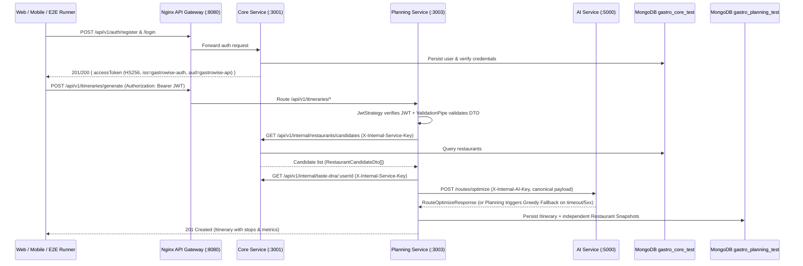

# GastroWise — M10.12 Authenticated Itinerary Generation & Full Planning E2E

- **Repository:** `maanxx/KLTN-123-GastroWise-BE`
- **Milestone:** M10.12 — Authenticated Itinerary Generation & Full Planning E2E
- **Scope:** End-to-end authenticated itinerary lifecycle through Nginx API Gateway, Planning Service ownership/snapshot hardening, reusable local-only E2E fixtures, NestJS HTTP integration tests, and live multi-service verification.

> **Strict Safety Rule:** All automated tests and live demos run exclusively against local Docker containers (`gastro_core_test`, `gastro_planning_test`). Never connect to MongoDB Atlas, never run remote migrations, never overwrite `.env`, and never execute `docker compose down -v`.

---

## 1. Architecture & Request Flow



### Database Ownership & Security Boundaries
- **Core Service** exclusively owns `gastro_core_test` (`users`, `restaurants`, `menuitems`, `tastednas`, `interactions`).
- **Planning Service** exclusively owns `gastro_planning_test` (`itineraries`) and persists restaurant stop data as **independent Snapshot Value Objects** (`restaurant_id`, `restaurant_name`, `restaurant_lat`, `restaurant_lng`, `restaurant_address`, `restaurant_rating`, `restaurant_image`, `tags`, `estimated_cost`).
- **AI Service** has read-only access on `gastro_core_test` and requires `X-Internal-AI-Key` on `POST /routes/optimize` (`401` missing, `403` invalid).
- **Cross-DB Access:** Enforced by MongoDB SCRAM-SHA-256 least-privilege credentials (`Core -> Planning = Unauthorized`, `Planning -> Core = Unauthorized`).

---

## 2. Phase 1 Audit Findings & Hardening Applied

Before writing E2E tests, inspecting the existing Planning & Core codebase identified four security/integrity gaps that were fixed cleanly without breaking any existing Web/Admin/Mobile API contracts:

1. **IDOR Fix on `GET /api/v1/itineraries/:id`:** Previously, `ItinerariesController.getItineraryById` did not pass `actorRole`, and `ItinerariesService.getItineraryById` accepted `userId` without checking ownership, permitting cross-user itinerary reads. Now enforces strict owner-or-admin checks (`403 Forbidden` for cross-user access), and all ownership checks across `reorderStops`, `addStop`, `removeStop`, `recalculateItinerary`, `updateStatus`, and `deleteItinerary` enforce ownership even when `actorRole` is omitted.
2. **Prevent Partial Persistence on AI Auth/Contract Rejection:** `generateItinerary()` now checks `ForbiddenException` (`403`) and `BadRequestException` (`400`/`422`) alongside `UnauthorizedException` (`401`) when calling `AiApiClient.optimizeRoute`, aborting cleanly without saving partial or inconsistent itinerary records. Timeout (`ECONNABORTED`) and `5xx`/`ECONNREFUSED` still trip the circuit breaker into `Gastronomic Greedy Fallback`.
3. **Complete Independent Restaurant Snapshots:** `generateItinerary()`, `addStop()`, and `recalculateTimetableAndMetrics()` now persist and preserve `restaurant_address`, `restaurant_rating`, and `restaurant_image` on every `ItineraryStop` snapshot so Planning records remain self-contained across reorders and recalculations.
4. **Backwards-Compatible `stop_count` & Safe Async Telemetry:** `generateItinerary()` honors `dto.desired_stops ?? dto.stop_count ?? 3`, and non-blocking Core completion telemetry (`recordInteraction` / `applyFeedback`) attaches `.catch()` handlers to prevent unhandled promise rejections.

---

## 3. Actual API Endpoints & Verified Payload Examples

All public endpoints are accessed via Nginx API Gateway at `http://127.0.0.1:8080`:

| Method | Endpoint | Auth | Purpose |
|---|---|---|---|
| `POST` | `/api/v1/auth/register` | Public | Create user account and issue JWT (`201`) |
| `POST` | `/api/v1/auth/login` | Public | Authenticate user and issue JWT (`200`) |
| `POST` | `/api/v1/itineraries/generate` | Bearer JWT | Generate & persist optimized itinerary (`201`) |
| `GET` | `/api/v1/itineraries` | Bearer JWT | List itineraries owned by current user (`200`) |
| `GET` | `/api/v1/itineraries/all` | Bearer JWT (`admin`) | Admin-only full list (`200` / `403`) |
| `GET` | `/api/v1/itineraries/:id` | Bearer JWT (Owner/Admin) | Get single itinerary with snapshots (`200` / `403` / `404`) |
| `PATCH` | `/api/v1/itineraries/:id/reorder` | Bearer JWT (Owner/Admin) | Reorder stops & recalculate timetable (`200` / `403`) |
| `POST` | `/api/v1/itineraries/:id/recalculate` | Bearer JWT (Owner/Admin) | Update budget/start_time/routing_mode & recalculate (`201` / `403`) |
| `POST` | `/api/v1/itineraries/:id/stops` | Bearer JWT (Owner/Admin) | Fetch Core snapshot via internal API & add stop (`201` / `403`) |
| `DELETE` | `/api/v1/itineraries/:id/stops/:stopId` | Bearer JWT (Owner/Admin) | Remove stop & recalculate (`200` / `403`) |
| `PATCH` | `/api/v1/itineraries/:id` | Bearer JWT (Owner/Admin) | Update status (`confirmed` / `completed` / `cancelled`) (`200` / `403`) |
| `DELETE` | `/api/v1/itineraries/:id` | Bearer JWT (Owner/Admin) | Delete owned itinerary (`200` / `403` / `404`) |

### Generate Itinerary Request Example
```json
{
  "prompt": "Food tour ẩm thực Sài Gòn ngon bổ rẻ",
  "start_time": "11:00",
  "end_time": "15:00",
  "lat": 10.7769,
  "lng": 106.7009,
  "budget": 300000,
  "desired_stops": 2,
  "routing_mode": "motorbike"
}
```

### Generate Itinerary Response Shape (`HTTP 201`)
```json
{
  "_id": "6b0b14157d1bd5fdf1e4b8fe",
  "user_id": "6b0b14145db7dc5864f629c4",
  "status": "generated",
  "budget": 300000,
  "total_cost": 145000,
  "remaining_budget": 155000,
  "routing_mode": "motorbike",
  "optimizedBy": "Gastronomic Progression Heuristic",
  "stops": [
    {
      "stop_id": "a1b2c3d4-...",
      "restaurant_id": "6b0a8f389e583fdd0ef73e28",
      "order_index": 1,
      "restaurant_name": "Bánh Mì Huynh Hoa",
      "restaurant_lat": 10.7722,
      "restaurant_lng": 106.6921,
      "restaurant_address": "26 Lê Thị Riêng, Quận 1, TP. HCM",
      "restaurant_rating": 4.7,
      "meal_type": "starter",
      "arrival_time": "11:03",
      "departure_time": "11:48",
      "estimated_cost": 65000
    }
  ]
}
```

---

## 4. Authentication Procedure

1. **Production / Live Gateway Flow:** Clients register (`POST /api/v1/auth/register`) or log in (`POST /api/v1/auth/login`) via Nginx Gateway (`:8080`). Core Service signs an HS256 JWT containing `{ sub, email, role }` with `issuer: "gastrowise-auth"` and `audience: "gastrowise-api"` using the shared `JWT_SECRET`.
2. **Planning Verification:** Planning Service's `JwtStrategy` extracts `Authorization: Bearer <accessToken>`, verifies signature, expiry, `issuer`, and `audience`, and attaches `{ userId: sub, sub, email, role }` to `req.user`.
3. **Test Fixtures (`scripts/e2e/fixtures/itinerary-e2e.fixtures.mjs`):**
   - Registers ephemeral local test users (`e2e-m1012-*@local.gastrowise.test`) through the live auth API.
   - Provides `signTestJwt(payload, testSecret)` (pure Node `crypto`) for negative wrong-secret `401` verification without extra dependencies.
   - Cleans up only test-owned itineraries and ephemeral test users in a `finally` block.

---

## 5. Docker & Local Database Prerequisites

1. Ensure `.env.docker.local` is configured from `.env.example` with local-only credentials (never commit `.env.docker.local`; never overwrite `.env`).
2. Validate Compose config and start all 5 local containers:
   ```bash
   docker compose --env-file .env.docker.local config -q
   docker compose --env-file .env.docker.local build planning-service
   docker compose --env-file .env.docker.local up -d --wait
   ```
3. Confirm all 5 containers (`gastrowise-mongo-test`, `gastrowise-core-service`, `gastrowise-planning-service`, `gastrowise-ai-service`, `gastrowise-nginx-gateway`) report `status=running | health=healthy | restarts=0`.
4. Ensure local `gastro_core_test.restaurants` has at least 2 seeded geocoded restaurants (the M10.7 local dataset contains 3 HCMC restaurants).
5. Stop safely after testing without deleting volumes:
   ```bash
   docker compose --env-file .env.docker.local stop
   ```

---

## 6. Test Scenarios & Observed Results

### A. Static Checks, Independent Builds & Automated Jest Suites
| Command | Status | Observed Result |
|---|---|---|
| `node --check scripts/e2e/fixtures/itinerary-e2e.fixtures.mjs` & `itinerary-e2e.mjs` | **PASS** | Exit `0` |
| `E2E_BASE_URL=https://api.gastrowise.vn node scripts/e2e/itinerary-e2e.mjs` | **PASS** | Exited `1` (refused non-local host) |
| `MONGODB_URI_PLANNING=mongodb+srv://... node scripts/e2e/itinerary-e2e.mjs` | **PASS** | Exited `1` (refused Atlas URI) |
| `npx tsc -p tsconfig.build.json --noEmit` | **PASS** | Exit `0` |
| `npm run build:shared && npm run build:core && npm run build:planning` | **PASS** | Exit `0` (independent builds succeeded) |
| `npm run test:microservices` | **PASS** | **38/38 suites passed, 294/294 tests passed** (includes new `itineraries.integration.spec.ts` covering JWT `401`, validation `400`, Core/AI internal headers, AI timeout greedy fallback, AI `403`/`422` zero-persistence abort, snapshot completeness, cross-user `403` matrix, admin override, `404`, and delete cleanup) |

### B. Live Multi-Service E2E Execution Through Nginx (`E2E_CHECK_DOCKER=true npm run test:e2e:itinerary`)
Executed against live Docker stack (all 5 containers `running`, `healthy`, `restarts=0`):

| Stage | Verified Scenarios | Observed Result |
|---|---|---|
| **Stage 1: Auth** | Unauth `401`, forged/wrong-secret JWT `401`, ephemeral User A & User B register + login via Nginx -> Core Auth, deterministic local candidates loaded | **5/5 PASS** |
| **Stage 2: Validation & Mesh** | Missing body `400`, `[0,0]` coords `400`, Core internal `/candidates` (`noKey=401, badKey=401, validKey=200, candidates=3`), AI `/routes/optimize` (`noKey=401, badKey=403, validKey=200`), bidirectional MongoDB SCRAM DB isolation (`Unauthorized` both ways) | **5/5 PASS** |
| **Stage 3: Generate & Persist** | `POST /api/v1/itineraries/generate` (`201`, 2 stops, complete snapshots, `cost=145000 VND`), `GET /api/v1/itineraries` (`200`), `GET /api/v1/itineraries/:id` (`200`), DB ownership (`gastro_planning_test=1, gastro_core_test=0`) | **4/4 PASS** |
| **Stage 4: Mutations** | `PATCH /:id/reorder` (`200`, snapshots preserved), `POST /:id/recalculate` (`201`), `POST /:id/stops` (`201`, 3 stops), `DELETE /:id/stops/:stopId` (`200`, 2 stops), `PATCH /:id` (`200`, `status=confirmed`, `confirmedBy` audit trail) | **5/5 PASS** |
| **Stage 5: Ownership & AuthZ** | User B list isolated (`0`), User B denied `403` across all 7 read/update/reorder/recalculate/stops/delete endpoints, non-admin `/all` denied `403`, missing ID returns `404` | **4/4 PASS** |
| **Stage 6: Delete, Security & Cleanup** | Owner `DELETE /:id` (`200`) -> subsequent `GET` (`404`), 28 API responses scanned (`0` secret leaks), ephemeral users (`2`) & itineraries (`0` leftover) cleaned up | **3/3 PASS** |
| **Total** | **`E2E_CHECK_DOCKER=true npm run test:e2e:itinerary`** | **`26 PASS, 0 FAIL, 0 SKIP (Total: 26)`** |

---

## 7. Known Limitations

1. **AI Solver Variant in Slim Local Image:** In the local `python:3.12-slim` AI container, `POST /routes/optimize` returns `HTTP 200` using its built-in `Gastronomic Progression Heuristic` solver when `ortools` is not installed; Planning Service's timeout/5xx circuit breaker (`Gastronomic Greedy Fallback`) is verified deterministically in `apps/planning-service/src/itineraries/itineraries.integration.spec.ts`.
2. **Local Seed Dataset Size:** Local `gastro_core_test` currently contains 3 sample restaurants (enough for 2–3 stop tours); larger demo tours (4–6 stops) should ingest additional local records via M10.7.
3. **Remote GitHub Actions CI:** Local checks pass in full; remote GitHub Actions workflows execute automatically after pushing the branch and opening the PR on GitHub.

---

## 8. Graduation Demo Runbook (Authenticated Planning Flow)

```bash
# 1. Start full isolated local stack
docker compose --env-file .env.docker.local up -d --wait

# 2. Run the full 26-check authenticated itinerary E2E suite through Nginx Gateway
E2E_CHECK_DOCKER=true npm run test:e2e:itinerary

# 3. (Optional) Run without Docker exec internals (host gateway HTTP-only mode)
npm run test:e2e:itinerary

# 4. Stop safely after demo (NEVER use -v)
docker compose --env-file .env.docker.local stop
```
