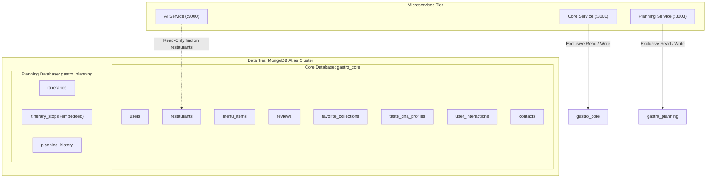

# GASTROWISE – DATABASE PER SERVICE & DATA OWNERSHIP SPECIFICATION
**Thesis:** Xây dựng hệ thống thông tin trải nghiệm ẩm thực thông minh (GastroWise)  
**Author:** Senior Software Architect & Tech Lead  
**Audit Date:** November 17, 2026  
**Status:** PHASE 0 COMPLETED — DATABASE ISOLATION FORMALIZED  

---

## 1. DATABASE PER SERVICE TOPOLOGY

To uphold the microservices principle of data isolation, GastroWise transitions from a single shared database (`gastrowise`) to independent logical databases:



---

## 2. COLLECTION & FIELD OWNERSHIP MATRIX

| Collection Name | Target Database | Exclusive Writer | Readers | Index Strategy |
| :--- | :---: | :---: | :---: | :--- |
| **`users`** | `gastro_core` | **Core Service** | Core Service | `email` (unique), `role` |
| **`restaurants`** | `gastro_core` | **Core Service** | Core Service, AI (Read-Only) | `location: "2dsphere"`, text on `tenQuan`, `diaChi`, `tags` |
| **`menu_items`** | `gastro_core` | **Core Service** | Core Service | `restaurantId`, `category` |
| **`reviews`** | `gastro_core` | **Core Service** | Core Service | `restaurantId`, `userId`, `createdAt` |
| **`favorite_collections`** | `gastro_core` | **Core Service** | Core Service | `userId`, `isPublic` |
| **`taste_dna_profiles`** | `gastro_core` | **Core Service** | Core Service | `userId` (unique) |
| **`user_interactions`** | `gastro_core` | **Core Service** | Core Service | `userId`, `targetId`, `eventType`, `createdAt` |
| **`contacts`** | `gastro_core` | **Core Service** | Core Service | `status`, `createdAt` |
| **`itineraries`** | `gastro_planning` | **Planning Service** | Planning Service | `user_id`, `created_at`, `shareToken` |
| **`planning_history`** | `gastro_planning` | **Planning Service** | Planning Service | `itinerary_id`, `timestamp` |

---

## 3. DATA DUPLICATION VS. REFERENCING POLICY

### The Cross-Service Data Dilemma
When an itinerary is generated, how should it reference the restaurants visited?

```
APPROACH 1 (Monolith - Tightly Coupled):
Itinerary stores ObjectId("6724...") -> calls Mongoose populate('restaurant_id').
❌ Fails in Microservices: Planning cannot access Core's restaurant collection!

APPROACH 2 (Chatty REST Queries):
Itinerary stores ObjectId("6724...") -> on every GET /itineraries/:id, Planning calls Core REST API 3-5 times.
❌ Inefficient: Generates heavy network overhead and cascades Core failures to historical tours!

APPROACH 3 (GastroWise Target: Snapshot Value Pattern):
Itinerary stores:
- restaurant_id (ObjectId string reference)
- restaurant_name (String snapshot)
- restaurant_lat / lng (Coordinate snapshots)
- estimated_cost (Number snapshot)
✅ RECOMMENDED & ADOPTED: Zero network overhead on view; historical tours remain intact forever!
```

---

## 4. DATABASE MIGRATION PROCEDURE (FROM `gastrowise` TO ISOLATED DBS)

During Week 3 & 4 execution, existing database data will be split cleanly without downtime using MongoDB aggregation `$out`:

```javascript
// Migration Script: Split gastrowise into gastro_core and gastro_planning

// 1. Populate gastro_core
db.getSiblingDB("gastrowise").users.aggregate([{ $out: { db: "gastro_core", coll: "users" } }]);
db.getSiblingDB("gastrowise").restaurants.aggregate([{ $out: { db: "gastro_core", coll: "restaurants" } }]);
db.getSiblingDB("gastrowise").menu_items.aggregate([{ $out: { db: "gastro_core", coll: "menu_items" } }]);
db.getSiblingDB("gastrowise").reviews.aggregate([{ $out: { db: "gastro_core", coll: "reviews" } }]);
db.getSiblingDB("gastrowise").favorite_collections.aggregate([{ $out: { db: "gastro_core", coll: "favorite_collections" } }]);
db.getSiblingDB("gastrowise").taste_dna_profiles.aggregate([{ $out: { db: "gastro_core", coll: "taste_dna_profiles" } }]);
db.getSiblingDB("gastrowise").user_interactions.aggregate([{ $out: { db: "gastro_core", coll: "user_interactions" } }]);
db.getSiblingDB("gastrowise").contacts.aggregate([{ $out: { db: "gastro_core", coll: "contacts" } }]);

// 2. Populate gastro_planning
db.getSiblingDB("gastrowise").itineraries.aggregate([{ $out: { db: "gastro_planning", coll: "itineraries" } }]);

// 3. Verify Indexes
db.getSiblingDB("gastro_core").restaurants.createIndex({ location: "2dsphere" });
db.getSiblingDB("gastro_planning").itineraries.createIndex({ user_id: 1, createdAt: -1 });
```

**Zero Data Loss Guarantee:** The original `gastrowise` database is retained untouched during development, providing an instantaneous rollback path.

