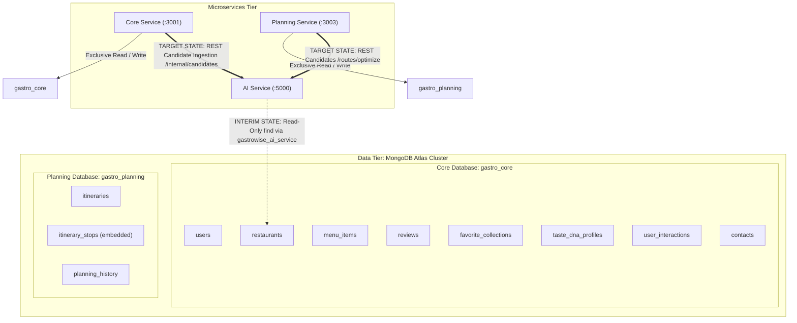

# GASTROWISE – DATABASE PER SERVICE & DATA OWNERSHIP SPECIFICATION
**Thesis:** Xây dựng hệ thống thông tin trải nghiệm ẩm thực thông minh (GastroWise)  
**Author:** Senior Software Architect & Tech Lead  
**Last Updated:** November 17, 2026 (Architecture Review Remediation)  
**Status:** REVISED & FORMALIZED — DATABASE ISOLATION & ROLLBACK DRILL DEFINED  

---

## 1. DATABASE PER SERVICE TOPOLOGY

To uphold the microservices principle of data isolation, GastroWise transitions from a single shared database (`gastrowise`) to independent logical databases.

### A. Current vs. Target Topology



### B. Architectural State Definition for AI Database Access
- **CURRENT / INTERIM STATE (Phase 0 - Phase 3):**
  - AI Service has a dedicated least-privilege MongoDB Atlas user `gastrowise_ai_service`.
  - Authorized resource: `gastrowise.restaurants` (and later `gastro_core.restaurants`).
  - Authorized action: `find` ONLY. All write/update/delete operations and queries to other collections are strictly blocked by Atlas RBAC (verified code 8000).
  - Business Purpose: Fast in-memory startup loading of 178 restaurant vectors and TF-IDF matrix without saturating HTTP bandwidth during early development.
- **TARGET STATE (Phase 4 & Production Milestone):**
  - **Zero Database Sharing Principle:** AI Service terminates all direct MongoDB Atlas connections.
  - Core Service owns the catalog exclusively and streams candidate venues to AI via internal REST `/internal/restaurants/candidates` or snapshot payload during inference calls (`/recommend/hybrid`, `/routes/optimize`).

---

## 2. COLLECTION & FIELD OWNERSHIP MATRIX

| Collection Name | Target Database | Exclusive Writer | Readers (Current/Interim) | Readers (Target State) | Index Strategy |
| :--- | :---: | :---: | :---: | :---: | :--- |
| **`users`** | `gastro_core` | **Core Service** | Core Service | Core Service | `email` (unique), `role` |
| **`restaurants`** | `gastro_core` | **Core Service** | Core Service, AI (Read-Only) | **Core Service ONLY** | `location: "2dsphere"`, text on `tenQuan`, `diaChi`, `tags` |
| **`menu_items`** | `gastro_core` | **Core Service** | Core Service | Core Service | `restaurantId`, `category` |
| **`reviews`** | `gastro_core` | **Core Service** | Core Service | Core Service | `restaurantId`, `userId`, `createdAt` |
| **`favorite_collections`** | `gastro_core` | **Core Service** | Core Service | Core Service | `userId`, `isPublic` |
| **`taste_dna_profiles`** | `gastro_core` | **Core Service** | Core Service | Core Service | `userId` (unique) |
| **`user_interactions`** | `gastro_core` | **Core Service** | Core Service | Core Service | `userId`, `targetId`, `eventType`, `createdAt` |
| **`contacts`** | `gastro_core` | **Core Service** | Core Service | Core Service | `status`, `createdAt` |
| **`itineraries`** | `gastro_planning` | **Planning Service** | Planning Service | Planning Service | `user_id`, `created_at`, `shareToken` |
| **`planning_history`** | `gastro_planning` | **Planning Service** | Planning Service | Planning Service | `itinerary_id`, `timestamp` |

---

## 3. DATA DUPLICATION VS. REFERENCING POLICY

### The Cross-Service Data Dilemma
When an itinerary is generated, how should it reference the restaurants visited?

```
APPROACH 1 (Monolith - Tightly Coupled):
Itinerary stores ObjectId("6724...") -> calls Mongoose populate('restaurant_id').
❌ Fails in Microservices: Planning cannot access Core's restaurant collection!

APPROACH 2 (Chatty REST Queries):
Itinerary stores ObjectId("6724...") -> on every GET /itineraries/:id, Planning calls Core REST API 3-5 times.
❌ Inefficient: Generates heavy network overhead and cascades Core failures to historical tours!

APPROACH 3 (GastroWise Target: Snapshot Value Pattern):
Itinerary stores:
- restaurant_id (ObjectId string reference)
- restaurant_name (String snapshot)
- restaurant_lat / lng (Coordinate snapshots)
- estimated_cost (Number snapshot)
✅ RECOMMENDED & ADOPTED: Zero network overhead on view; historical tours remain intact forever!
```

---

## 4. ROBUST DATABASE MIGRATION STRATEGY (ZERO DATA LOSS)

Transitioning from `gastrowise` to `gastro_core` and `gastro_planning` involves data splitting. Using raw MongoDB `$out` alone poses severe operational risks: `$out` drops existing indexes on the target and replaces existing collections atomically without verification.

To prevent data loss or index degradation, GastroWise enforces a strict 4-stage procedure:

### Stage 4.1: Pre-Migration Backup Gate (Mandatory)
Before executing any aggregation or split script:
1. Trigger MongoDB Atlas Cloud Backup Snapshot with label `pre-microservices-split-YYYYMMDD`.
2. Execute offline export via `mongodump`:
   ```bash
   mongodump --uri="<MONGODB_ADMIN_URI>" --db=gastrowise --out="./backup/gastrowise_pre_split"
   ```
3. Verify backup checksum and document count matching.

### Stage 4.2: Execution via Controlled Pipeline
Run migration using `$merge` instead of raw `$out` to preserve existing collections and index metadata where applicable:
```javascript
// migrations/split-databases.js

// 1. Core Collections Migration
const coreCollections = [
  "users", "restaurants", "menu_items", "reviews", 
  "favorite_collections", "taste_dna_profiles", "user_interactions", "contacts"
];

for (const coll of coreCollections) {
  print(`Migrating ${coll} to gastro_core...`);
  db.getSiblingDB("gastrowise")[coll].aggregate([
    { $match: {} },
    { $merge: { into: { db: "gastro_core", coll: coll }, whenMatched: "replace", whenNotMatched: "insert" } }
  ]);
}

// 2. Planning Collections Migration
print("Migrating itineraries to gastro_planning...");
db.getSiblingDB("gastrowise").itineraries.aggregate([
  { $match: {} },
  { $merge: { into: { db: "gastro_planning", coll: "itineraries" } } }
]);
```

### Stage 4.3: Post-Migration Validation & Index Reconstruction
1. **Document Parity Check:**
   ```javascript
   const coreColl = ["users", "restaurants", "menu_items", "reviews", "favorite_collections", "taste_dna_profiles", "user_interactions", "contacts"];
   for (const c of coreColl) {
     const orig = db.getSiblingDB("gastrowise")[c].countDocuments();
     const target = db.getSiblingDB("gastro_core")[c].countDocuments();
     assert(orig === target, `PARITY FAIL in ${c}: ${orig} !== ${target}`);
   }
   const origItin = db.getSiblingDB("gastrowise").itineraries.countDocuments();
   const targetItin = db.getSiblingDB("gastro_planning").itineraries.countDocuments();
   assert(origItin === targetItin, `PARITY FAIL in itineraries: ${origItin} !== ${targetItin}`);
   print("✅ ALL DOCUMENT COUNTS VERIFIED 100% PARITY");
   ```
2. **Index Reconstruction:**
   ```javascript
   db.getSiblingDB("gastro_core").restaurants.createIndex({ location: "2dsphere" });
   db.getSiblingDB("gastro_core").users.createIndex({ email: 1 }, { unique: true });
   db.getSiblingDB("gastro_planning").itineraries.createIndex({ user_id: 1, createdAt: -1 });
   ```
3. **Geospatial Probe:**
   Execute a sample `$near` query on `gastro_core.restaurants` to verify geospatial index performance.

### Stage 4.4: Rollback Strategy
If parity check fails or service connection issues arise:
1. Revert connection strings in `.env` of Core Service and Planning Service back to `MONGODB_URI=.../gastrowise`.
2. Legacy `gastrowise` database was treated as READ-ONLY during migration and remains 100% untouched.
3. Drop failed target databases `gastro_core` and `gastro_planning`.
4. Zero downtime rollback completed in $< 2\text{ minutes}$.
