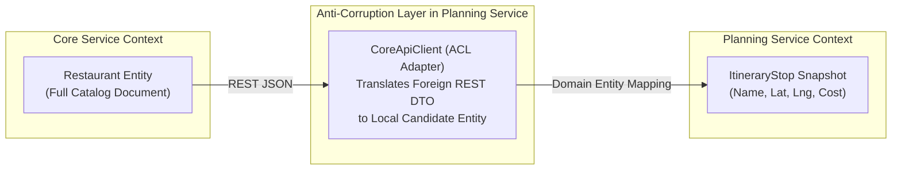

# GASTROWISE – SERVICE BOUNDARIES & ANTI-CORRUPTION LAYER SPECIFICATION
**Thesis:** Xây dựng hệ thống thông tin trải nghiệm ẩm thực thông minh (GastroWise)  
**Author:** Senior Software Architect & Tech Lead  
**Last Updated:** November 17, 2026 (Architecture Review Remediation)  
**Status:** REVISED & FORMALIZED — BOUNDARY PROTOCOLS & SECURITY GAPS IDENTIFIED  

---

## 1. SERVICE BOUNDARY PRINCIPLES & DECOUPLING STRATEGY

To preserve the independence of Core, Planning, and AI services, all inter-service boundaries adhere to three architectural rules:

1. **Zero Database Sharing Principle:**
   - **Target State (Pure Microservices Architecture):** No service connects to or executes queries against another service's database. Core Service exclusively provides restaurant candidate representations to Planning and AI via REST or asynchronous data push.
   - **Interim Transition State (Phase 0 - Phase 3):** To support high-performance startup loading of the 178-venue vector space for TF-IDF and SVD without building complex sync pipelines immediately, the AI Service is granted strictly isolated, read-only `find` access to `restaurants` collection via MongoDB Atlas least-privilege user `gastrowise_ai_service`. In Phase 4 (Milestone 4 / ADR-05), this direct connection is deprecated and replaced by REST-based candidate streaming.
2. **Zero Code Dependency:** No service imports another service's internal domain models, controllers, or repositories.
3. **Anti-Corruption Layer (ACL):** Services protect their domain integrity by translating foreign API representations through dedicated adapter interfaces.



---

## 2. ANTI-CORRUPTION LAYER (ACL) IMPLEMENTATION FOR PLANNING SERVICE

In the current monolith, `ItinerariesService` directly imports `Restaurant` schema, creating dangerous coupling: if the restaurant schema evolves, itinerary calculations break.

In the target microservice architecture, the Planning Service implements an **Anti-Corruption Layer (ACL)**:

### 2.1. Candidate Translation Port & Adapter
```typescript
// apps/planning-service/src/application/ports/restaurant-client.port.ts
export interface RestaurantCandidate {
  id: string;
  name: string;
  lat: number;
  lon: number;
  avgPrice: number;
  mealType: 'starter' | 'main' | 'dessert' | 'cafe';
  rating: number;
  tags: string;
}

export interface IRestaurantClient {
  getCandidates(params: {
    lat: number;
    lon: number;
    radiusKm: number;
    budget: number;
    dietaryRestrictions?: string[];
  }): Promise<RestaurantCandidate[]>;
}
```

### 2.2. Immutable Stop Snapshot Design
Instead of referencing `Restaurant` documents via Mongoose `populate()`, the Planning Service persists immutable value snapshots inside `ItineraryStop`:

```typescript
// apps/planning-service/src/domain/entities/itinerary-stop.entity.ts
export class ItineraryStopSnapshot {
  stop_id: string;
  order_index: number;
  restaurant_id: string;      // Foreign Reference Key
  restaurant_name: string;    // Snapshot at tour generation time
  restaurant_lat: number;     // Snapshot coordinate
  restaurant_lng: number;     // Snapshot coordinate
  meal_type: string;
  arrival_time: string;
  departure_time: string;
  dining_duration_mins: number;
  transit_time_mins: number;
  distance_to_next_km: number;
  estimated_cost: number;
}
```

**Architectural Benefit:** If a restaurant changes its business name, relocates, or shuts down, the user's historical itinerary remains fully legible, geographically valid, and visually coherent.

---

## 3. INTER-SERVICE COMMUNICATION PROTOCOLS

### 3.1. Distributed Tracing via Correlation ID
All incoming gateway requests generate or forward a unique UUID `X-Correlation-Id`:

```
Client Request
      │
      ▼
[API Gateway] ──(Injects X-Correlation-Id: "req_f81d4fae-7dec...")
      │
      ├──> [Planning Service] ──(Propagates X-Correlation-Id)──> [AI Service]
      │
      └──> [Core Service]
```

All log entries across Core, Planning, and AI format output with `[CorrelationId: req_...]` to enable seamless end-to-end distributed transaction tracing.

### 3.2. Mutual Internal Authentication Protocol (Current Gap vs Target State)
- **CURRENT AUDITED STATE (VULNERABILITY GAP):**
  - AI Service FastAPI has `allow_origins=["*"]` and checks **zero** authorization headers.
  - Backend NestJS makes HTTP calls without injecting any mutual authentication token.
  - Public can call AI Service directly on port 5000 bypassing business orchestration.
- **TARGET SECURED STATE (P0 IMPLEMENTATION):**
  - **Core $\rightarrow$ AI:** Header `X-Internal-AI-Key: <SECRET_AI_INTERNAL_KEY>` verified by FastAPI `Security(verify_internal_key)`.
  - **Planning $\rightarrow$ Core:** Header `X-Internal-Service-Key: <SECRET_CORE_INTERNAL_KEY>` verified by NestJS `InternalAuthGuard`.
  - Constant-time comparison (`crypto.timingSafeEqual` in Node.js, `secrets.compare_digest` in Python) to prevent timing side-channel attacks.

---

## 4. RESILIENCE: CIRCUIT BREAKER & TIMEOUT SPECIFICATION

```
┌────────────────────────────────────────────────────────────────────────┐
│                   CIRCUIT BREAKER STATE TRANSITION                     │
├────────────────────────────────────────────────────────────────────────┤
│                                                                        │
│        [CLOSED] ──(3 consecutive timeouts/failures)──> [OPEN]         │
│           ▲                                               │            │
│           │                                      (Cooldown 15s)        │
│           │                                               │            │
│      (2 successes) <── [HALF-OPEN] <──────────────────────┘            │
│                                                                        │
└────────────────────────────────────────────────────────────────────────┘
```

1. **State CLOSED:** Normal operation. Requests flow to downstream service (AI or Core).
2. **State OPEN:** Downstream service is failing. Circuit trips open immediately. All subsequent requests divert instantly to fallback heuristics (Greedy route planner / Rating sort) without waiting for HTTP timeouts.
3. **State HALF-OPEN:** After 15 seconds, a single canary probe request is sent. If it succeeds, the circuit closes; if it fails, the circuit resets to OPEN.
