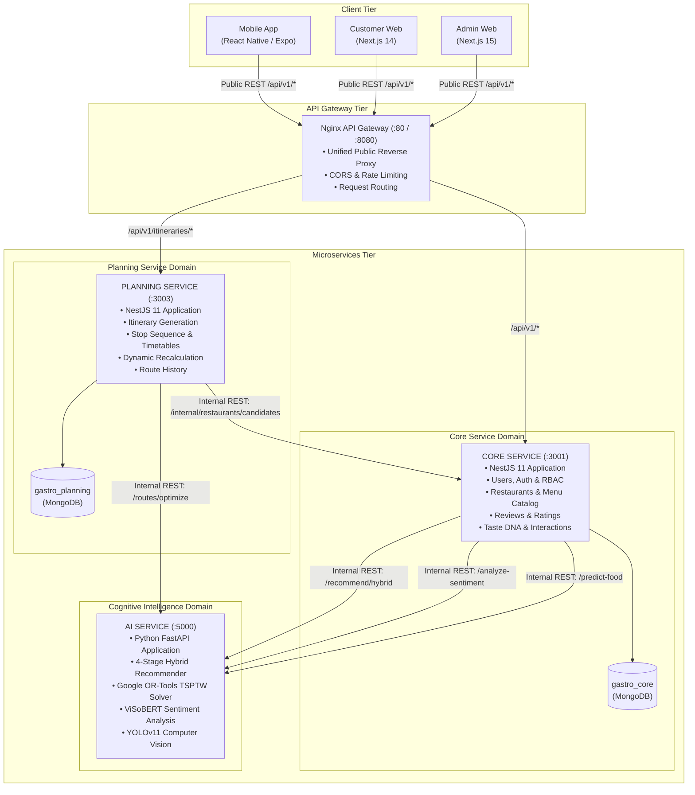
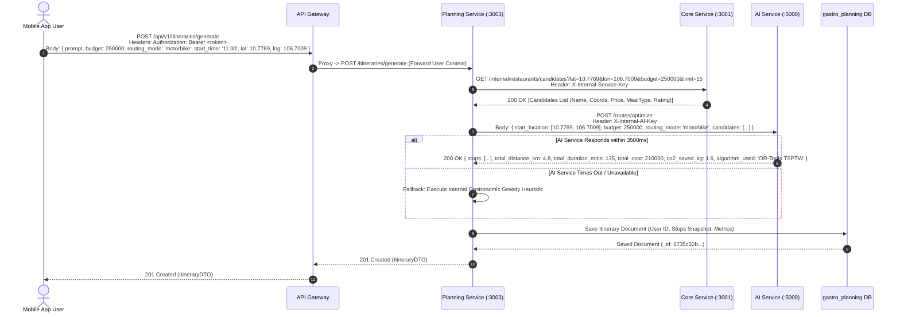
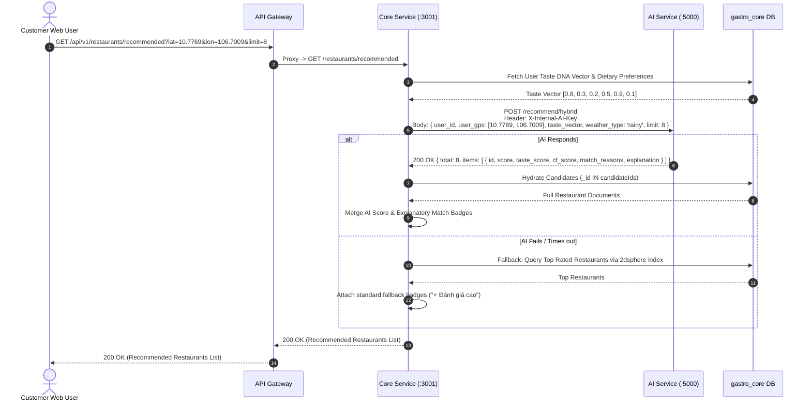

# GASTROWISE – TARGET MICROSERVICES ARCHITECTURE SPECIFICATION
**Thesis:** Xây dựng hệ thống thông tin trải nghiệm ẩm thực thông minh (GastroWise)  
**Author:** Senior Software Architect & Tech Lead  
**Audit Date:** November 17, 2026  
**Status:** PHASE 0 COMPLETED — TARGET ARCHITECTURE FORMALIZED  

---

## 1. TARGET SYSTEM ARCHITECTURE TOPOLOGY

The target GastroWise platform decouples the monolith into three autonomous backend services mediated by a unified API Gateway:



> [!NOTE]
> **Data Access Architectural Evolution (Interim vs Target State):**  
> - **Interim State (Phase 0–3):** AI Microservice reads directly from MongoDB Atlas `restaurants` collection using least-privilege credentials (`gastrowise_ai_service`).  
> - **Target State (Phase 4 / Production):** Zero Database Sharing is enforced. AI terminates all direct MongoDB connections; Core Service exclusively owns the catalog and streams candidate profiles directly in HTTP request payloads (`/recommend/hybrid`, `/routes/optimize`).

---

## 2. CLEAN ARCHITECTURE WITHIN INDEPENDENT SERVICES

Each NestJS service (`core-service` and `planning-service`) adheres to Clean Architecture layers to maintain high cohesion and low coupling:

```
apps/{service-name}/src/
├── domain/                  # Enterprise Business Rules
│   ├── entities/            # Domain Entities (e.g. Itinerary, Restaurant)
│   └── value-objects/       # GeoLocation, TimeWindow, TasteVector
│
├── application/             # Application Business Rules
│   ├── use-cases/           # GenerateItineraryUseCase, ReorderStopsUseCase
│   ├── dtos/                # Request & Response Data Transfer Objects
│   └── ports/               # Outbound interfaces (IRestaurantClient, IAiClient)
│
├── infrastructure/          # Frameworks & Drivers
│   ├── persistence/         # Mongoose Schemas & Repository Implementations
│   ├── http-clients/        # Axios clients for inter-service REST calls
│   └── config/              # Environment & Database connection factories
│
└── presentation/            # Interface Adapters
    ├── controllers/         # REST API Controllers
    ├── guards/              # JwtAuthGuard, RolesGuard, InternalAuthGuard
    └── interceptors/        # Logging, CorrelationId, ResponseFormat
```

---

## 3. MAIN BUSINESS FLOWS & SEQUENCE DIAGRAMS

### 3.1. Flow 1: Multi-Stop Itinerary Generation Flow



---

### 3.2. Flow 2: Personalized Restaurant Discovery Flow



---

## 4. FAULT TOLERANCE & GRACEFUL DEGRADATION SPECIFICATION

The target architecture enforces comprehensive failure handling so that external or downstream service crashes never bring down the user experience:

| Failure Scenario | Impacted Flow | Detection Mechanism | Graceful Degradation Strategy |
| :--- | :--- | :---: | :--- |
| **AI Service Down / Unreachable** | Itinerary Route Optimization | HTTP 503 or 3,500ms timeout | Planning Service switches immediately to internal **Gastronomic Progression Heuristic** (Starter $\rightarrow$ Main $\rightarrow$ Dessert/Cafe) and generates valid tours. |
| **AI Service Down / Unreachable** | Hybrid Recommendations | HTTP 503 or 3,000ms timeout | Core Service switches immediately to **MongoDB 2dsphere Proximity & Rating Sort**, returning popular nearby venues. |
| **AI Service Down / Unreachable** | Review Sentiment Analysis | HTTP 503 or 2,000ms timeout | Core Service returns default `NEUTRAL` sentiment with score `0.5`, allowing reviews to be published without error. |
| **Core Service Down / Unreachable** | Itinerary Generation | HTTP 503 or 3,000ms timeout | Planning Service returns a clean 503 response: *"Hệ thống dữ liệu nhà hàng đang bảo trì. Vui lòng thử lại sau ít phút."* |
| **Planning Service Down** | Restaurant Discovery / Login | HTTP 502 / 504 from Gateway | Zero impact on Core Service. Users can browse restaurants, write reviews, and log in completely unaffected. |

