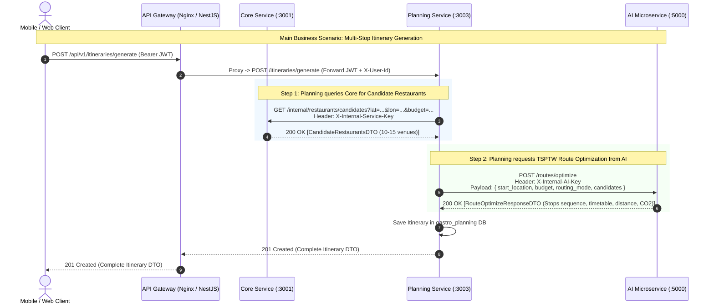

# GASTROWISE – INTER-SERVICE API DEPENDENCY & CONTRACT MATRIX
**Thesis:** Xây dựng hệ thống thông tin trải nghiệm ẩm thực thông minh (GastroWise)  
**Author:** Senior Software Architect & Tech Lead  
**Last Updated:** November 17, 2026 (Architecture Review Remediation)  
**Status:** REVISED & FORMALIZED — CONTRACT GAPS & SECURITY ENFORCEMENT DOCUMENTED  

---

## 1. END-TO-END COMMUNICATION TOPOLOGY

In the target Microservices Architecture, client traffic enters through the API Gateway, and services interact through defined synchronous REST APIs:

---

## 2. CROSS-SERVICE API DEPENDENCY SPECIFICATION

### 2.1. Client to API Gateway (Public REST API) & Access Control Specification

| Public Path | Target Service | Method | Auth Required | Enforcement Rule | Purpose |
| :--- | :---: | :---: | :---: | :--- | :--- |
| `/api/v1/auth/*` | **Core Service** | ALL | Public / JWT | Standard rate limit | Login, register, refresh tokens, Google OAuth, 2FA |
| `/api/v1/users/*` | **Core Service** | ALL | JWT (Admin / Self) | `RolesGuard` or ID match | User account management, role assignment |
| `/api/v1/restaurants/*` | **Core Service** | ALL | Public / Owner / Admin | Public read; Owner/Admin write | Restaurant catalog browsing, nearby search, menu CRUD |
| `/api/v1/reviews` | **Core Service** | `POST` | **JWT Required [P0]** | Extract `userId` from `req.user` | Post review (prevent user impersonation) |
| `/api/v1/reviews/:id` | **Core Service** | `DELETE` / `PATCH` | **JWT + Owner/Admin [P0]** | Verify `review.userId === req.user.id` or `role === 'admin'` | Prevent unauthorized review deletion/tampering |
| `/api/v1/favorites/*` | **Core Service** | ALL | JWT | Self access | Toggling bookmarks and querying saved venues |
| `/api/v1/taste-dna/*` | **Core Service** | ALL | JWT | Self access | 6-D Taste DNA profile retrieval, quiz, calibration |
| `/api/v1/interactions` | **Core Service** | `POST` | Public / JWT | If unauthenticated: record as anonymous session | Behavioral event ingestion (click, dwell, view) |
| `/api/v1/interactions/matrix` | **Core Service** | `GET` | **Admin / Internal ONLY [P0]** | `Roles(Role.Admin)` OR `X-Internal-Service-Key` | Interaction matrix export (protect against data exfiltration) |
| `/api/v1/contacts/*` | **Core Service** | ALL | Public / Admin | Public create; Admin view | User feedback, inquiries, email notifications |
| `/api/v1/itineraries/*` | **Planning Service**| ALL | JWT | Self access | Food tour generation, retrieval, stop reordering |

---

### 2.2. Planning Service to Core Service (Internal REST API)

| Internal Endpoint | HTTP Method | Authentication Header | Request Payload / Params | Response Payload | Error / Fallback Behavior |
| :--- | :---: | :---: | :--- | :--- | :--- |
| `/internal/restaurants/candidates` | `GET` | `X-Internal-Service-Key` | Query: `lat`, `lon`, `radiusKm`, `budget`, `dietaryRestrictions`, `limit=20` | `RestaurantCandidateDTO[]` | If Core is down: return 503 Service Unavailable with clear error message. |
| `/internal/restaurants/:id` | `GET` | `X-Internal-Service-Key` | Path: `id` (Restaurant ObjectId) | `RestaurantDetailDTO` | If not found: 404; if Core down: 503. |
| `/internal/taste-dna/:userId` | `GET` | `X-Internal-Service-Key` | Path: `userId` (User ObjectId) | `TasteDnaProfileDTO` (6-D vector) | If user has no profile: return neutral prior $[0.5, 0.5, ...]$. |
| `/internal/interactions/event` | `POST` | `X-Internal-Service-Key` | Body: `{ userId, eventType: 'itinerary_generate', targetId }` | `{ success: boolean }` | Non-blocking fire-and-forget: failure does not block itinerary creation. |

---

### 2.3. Planning Service to AI Service (Internal REST API)

| Internal Endpoint | HTTP Method | Authentication Header | Request Payload | Response Payload | Error / Fallback Behavior |
| :--- | :---: | :---: | :--- | :--- | :--- |
| `/routes/optimize` | `POST` | `X-Internal-AI-Key` | `RouteOptimizeRequest`: `{ start_location: [lat, lon], start_time_mins, budget, routing_mode, candidates: [...] }` | `RouteOptimizeResponse`: `{ stops: [...], total_distance_km, total_duration_mins, total_cost, co2_saved_kg, algorithm_used }` | **Fallback:** If AI Service is down or times out (>3500ms), Planning Service executes internal Gastronomic Greedy Heuristic. |

---

### 2.4. Core Service to AI Service (Internal REST API & Routing Contract Alignment)

> [!CAUTION]
> **Current Routing Discrepancy (P0 Defect):**  
> In the monolith codebase ([restaurants.service.ts:448, 547, 969](file:///D:/GastroWise/KLTN-123-GastroWise-BE/src/restaurants/restaurants.service.ts#L448)), Backend calls paths with `/v1/recommendation/...` and `/v1/copilot/...`. FastAPI currently mounts endpoints without `/v1`. Consequently, calls fail with 404.  
> **Contract Resolution:** During Milestone 4 (TASK-AI-01), FastAPI router will be standardized with dual-compatibility (both `/v1/...` and top-level aliases) and enforce `X-Internal-AI-Key`.

| Canonical Target Endpoint | Monolith Current Call Path | FastAPI Current Listen Path | Auth Header | Purpose | Fallback Behavior |
| :--- | :--- | :--- | :---: | :--- | :--- |
| `/recommend/hybrid` | `/v1/recommendation/recommend/hybrid` *(404 mismatch)* | `/recommend/hybrid` | `X-Internal-AI-Key` | 4-Stage Hybrid Recommender | Top rating sort from DB |
| `/cf/train` | `/v1/recommendation/cf/train` *(404 mismatch)* | `/cf/train` | `X-Internal-AI-Key` | SVD Collaborative Filtering train | Log error, keep prior weights |
| `/copilot/message` | `/v1/copilot/message` *(404 mismatch)* | `/copilot/message` | `X-Internal-AI-Key` | NLU Copilot dialogue engine | Regex search fallback |
| `/analyze-sentiment` | `/analyze-sentiment` *(Matched)* | `/analyze-sentiment` | `X-Internal-AI-Key` | ViSoBERT review sentiment | Default NEUTRAL (0.5) |
| `/predict-food` | `/predict-food` *(Port mismatch: 8000 vs 5000)* | `/predict-food` | `X-Internal-AI-Key` | YOLOv11 dish recognition | 503 Service Unavailable |
| `/weather-recommend` | `/weather-recommend` *(Matched)* | `/weather-recommend` | `X-Internal-AI-Key` | Weather-based recommendation | Default all-weather pool |

---

## 3. INTERNAL AUTHENTICATION & SECURITY HEADERS (GAP VS TARGET)

1. **`X-Internal-Service-Key` (Planning $\leftrightarrow$ Core):**
   - **Target Implementation:** Cryptographically random 256-bit secret string configured via `INTERNAL_SERVICE_SECRET`.
   - Verified on incoming requests via NestJS `InternalAuthGuard` using constant-time string comparison (`crypto.timingSafeEqual`).
2. **`X-Internal-AI-Key` (Core/Planning $\rightarrow$ AI):**
   - **Current State:** UNIMPLEMENTED in FastAPI (`allow_origins=["*"]`).
   - **Target Implementation:** Shared secret string configured via `AI_SECRET_KEY`. Verified on all FastAPI endpoints via `Depends(verify_internal_key)`.
3. **`X-User-Id` & `X-User-Role` (Gateway $\rightarrow$ Backend Services):**
   - Populated by API Gateway or extracted from verified JWT tokens.
   - Eliminates repetitive JWT re-verification across internal microservices while preserving user context.

---

## 4. SERVICE RESILIENCE & TIMEOUT BUDGETS

| Communication Leg | Protocol | Timeout SLA | Retry Policy | Circuit Breaker Policy |
| :--- | :---: | :---: | :--- | :--- |
| **Gateway $\rightarrow$ Core** | HTTP REST | 5,000ms | 1 retry on 502/504 | Open after 5 consecutive failures |
| **Gateway $\rightarrow$ Planning**| HTTP REST | 8,000ms | 0 retries on POST (non-idempotent) | Open after 5 consecutive failures |
| **Planning $\rightarrow$ Core** | HTTP REST | 3,000ms | 1 retry with 200ms backoff | Open after 3 consecutive failures |
| **Planning $\rightarrow$ AI (Routing)**| HTTP REST | 3,500ms | 0 retries $\rightarrow$ immediate fallback heuristic | Open after 3 timeouts |
| **Core $\rightarrow$ AI (Recs)** | HTTP REST | 3,000ms | 0 retries $\rightarrow$ immediate rating fallback | Open after 3 timeouts |
| **Core $\rightarrow$ AI (Sentiment)**| HTTP REST | 2,000ms | 0 retries $\rightarrow$ default neutral fallback | None (stateless fallback) |
