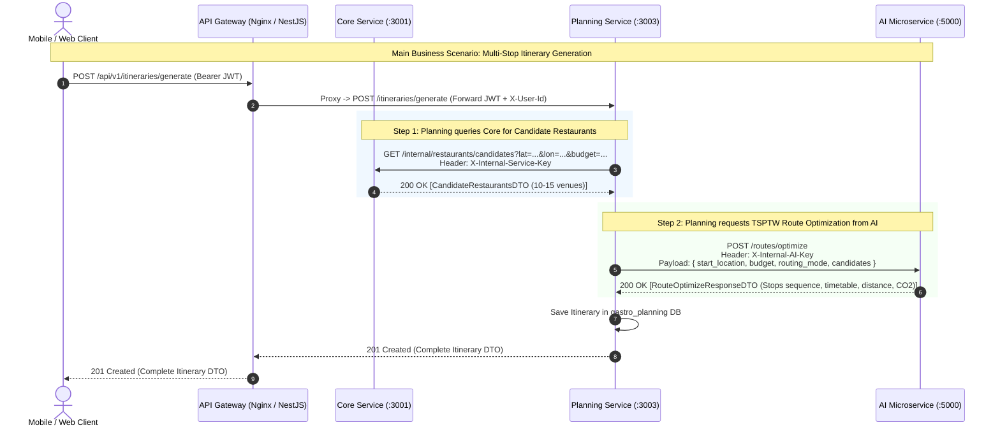

# GASTROWISE – INTER-SERVICE API DEPENDENCY & CONTRACT MATRIX
**Thesis:** Xây dựng hệ thống thông tin trải nghiệm ẩm thực thông minh (GastroWise)  
**Author:** Senior Software Architect & Tech Lead  
**Audit Date:** November 17, 2026  
**Status:** PHASE 0 COMPLETED — INTER-SERVICE CONTRACTS FORMALIZED  

---

## 1. END-TO-END COMMUNICATION TOPOLOGY

In the target Microservices Architecture, client traffic enters through the API Gateway, and services interact through defined synchronous REST APIs:

---

## 2. CROSS-SERVICE API DEPENDENCY SPECIFICATION

### 2.1. Client to API Gateway (Public REST API)

| Public Path | Target Service | Method | Auth Required | Purpose |
| :--- | :---: | :---: | :---: | :--- |
| `/api/v1/auth/*` | **Core Service** | ALL | Public / JWT | Login, register, refresh tokens, Google OAuth, 2FA |
| `/api/v1/users/*` | **Core Service** | ALL | JWT (Admin / Self) | User account management, role assignment |
| `/api/v1/restaurants/*` | **Core Service** | ALL | Public / Owner / Admin | Restaurant catalog browsing, nearby search, menu CRUD |
| `/api/v1/reviews/*` | **Core Service** | ALL | Public / JWT | Community reviews and rating submission |
| `/api/v1/favorites/*` | **Core Service** | ALL | JWT | Toggling bookmarks and querying saved venues |
| `/api/v1/taste-dna/*` | **Core Service** | ALL | JWT | 6-D Taste DNA profile retrieval, quiz, calibration |
| `/api/v1/interactions/*`| **Core Service** | ALL | Public / JWT | Behavioral event ingestion (click, dwell, view) |
| `/api/v1/contacts/*` | **Core Service** | ALL | Public / Admin | User feedback, inquiries, email notifications |
| `/api/v1/itineraries/*` | **Planning Service**| ALL | JWT | Food tour generation, retrieval, stop reordering |

---

### 2.2. Planning Service to Core Service (Internal REST API)

| Internal Endpoint | HTTP Method | Authentication Header | Request Payload / Params | Response Payload | Error / Fallback Behavior |
| :--- | :---: | :---: | :--- | :--- | :--- |
| `/internal/restaurants/candidates` | `GET` | `X-Internal-Service-Key` | Query: `lat`, `lon`, `radiusKm`, `budget`, `dietaryRestrictions`, `limit=20` | `RestaurantCandidateDTO[]` | If Core is down: return 503 Service Unavailable with clear error message. |
| `/internal/restaurants/:id` | `GET` | `X-Internal-Service-Key` | Path: `id` (Restaurant ObjectId) | `RestaurantDetailDTO` | If not found: 404; if Core down: 503. |
| `/internal/taste-dna/:userId` | `GET` | `X-Internal-Service-Key` | Path: `userId` (User ObjectId) | `TasteDnaProfileDTO` (6-D vector) | If user has no profile: return neutral prior $[0.5, 0.5, ...]$. |
| `/internal/interactions/event` | `POST` | `X-Internal-Service-Key` | Body: `{ userId, eventType: 'itinerary_generate', targetId }` | `{ success: boolean }` | Non-blocking fire-and-forget: failure does not block itinerary creation. |

---

### 2.3. Planning Service to AI Service (Internal REST API)

| Internal Endpoint | HTTP Method | Authentication Header | Request Payload | Response Payload | Error / Fallback Behavior |
| :--- | :---: | :---: | :--- | :--- | :--- |
| `/routes/optimize` | `POST` | `X-Internal-AI-Key` | `RouteOptimizeRequest`: `{ start_location: [lat, lon], start_time_mins, budget, routing_mode, candidates: [...] }` | `RouteOptimizeResponse`: `{ stops: [...], total_distance_km, total_duration_mins, total_cost, co2_saved_kg, algorithm_used }` | **Fallback:** If AI Service is down or times out (>3500ms), Planning Service executes internal Gastronomic Greedy Heuristic. |

---

### 2.4. Core Service to AI Service (Internal REST API)

| Internal Endpoint | HTTP Method | Authentication Header | Request Payload | Response Payload | Error / Fallback Behavior |
| :--- | :---: | :---: | :--- | :--- | :--- |
| `/recommend/hybrid` | `POST` | `X-Internal-AI-Key` | `HybridRecommendRequest`: `{ user_id, user_gps, taste_vector, weather_type, temperature, max_price, limit }` | `HybridRecommendResponse`: `{ total, is_cold_start, applied_weights, items: [...] }` | **Fallback:** If AI fails, Core executes `getFallbackRecommendations()` (top rating sort from DB). |
| `/cf/train` | `POST` | `X-Internal-AI-Key` | `TrainCFRequest`: `{ interactions: [...] }` | `TrainCFResponse`: `{ success, user_count, item_count }` | Asynchronous offline sync; failure logged to logger without user impact. |
| `/analyze-sentiment` | `POST` | `X-Internal-AI-Key` | `{ review: string }` | `{ label: 'POSITIVE'\|'NEGATIVE'\|'NEUTRAL', score, hashtags }` | **Fallback:** Returns `NEUTRAL` with score `0.5` if AI offline. |
| `/predict-food` | `POST` | `X-Internal-AI-Key` | Multipart form-data: `file` (image binary, max 5MB) | `VisionPredictResponse`: `{ detected_items: [...], primary_dish }` | Returns 503 Service Unavailable if vision model offline. |
| `/copilot/message` | `POST` | `X-Internal-AI-Key` | `CopilotChatRequest`: `{ message, user_gps, taste_vector }` | `CopilotChatResponse`: `{ reply, intent, entities, action_card, results }` | **Fallback:** Regex-based food search fallback with basic suggestion card. |

---

## 3. INTERNAL AUTHENTICATION & SECURITY HEADERS

Inter-service communications operate on zero-trust principles:

1. **`X-Internal-Service-Key` (Planning $\leftrightarrow$ Core):**
   - Cryptographically random 256-bit secret string configured via `INTERNAL_SERVICE_SECRET`.
   - Verified on incoming requests via NestJS `InternalAuthGuard` using constant-time string comparison.
2. **`X-Internal-AI-Key` (Core/Planning $\rightarrow$ AI):**
   - Shared secret string configured via `AI_SECRET_KEY`.
   - Verified on incoming FastAPI requests via `verify_internal_key` dependency.
3. **`X-User-Id` & `X-User-Role` (Gateway $\rightarrow$ Backend Services):**
   - Populated by API Gateway or extracted from verified JWT tokens.
   - Eliminates repetitive JWT re-verification across internal microservices while preserving user context.

---

## 4. SERVICE RESILIENCE & TIMEOUT BUDGETS

| Communication Leg | Protocol | Timeout SLA | Retry Policy | Circuit Breaker Policy |
| :--- | :---: | :---: | :--- | :--- |
| **Gateway $\rightarrow$ Core** | HTTP REST | 5,000ms | 1 retry on 502/504 | Open after 5 consecutive failures |
| **Gateway $\rightarrow$ Planning**| HTTP REST | 8,000ms | 0 retries on POST (non-idempotent) | Open after 5 consecutive failures |
| **Planning $\rightarrow$ Core** | HTTP REST | 3,000ms | 1 retry with 200ms backoff | Open after 3 consecutive failures |
| **Planning $\rightarrow$ AI (Routing)**| HTTP REST | 3,500ms | 0 retries $\rightarrow$ immediate fallback heuristic | Open after 3 timeouts |
| **Core $\rightarrow$ AI (Recs)** | HTTP REST | 3,000ms | 0 retries $\rightarrow$ immediate rating fallback | Open after 3 timeouts |
| **Core $\rightarrow$ AI (Sentiment)**| HTTP REST | 2,000ms | 0 retries $\rightarrow$ default neutral fallback | None (stateless fallback) |

