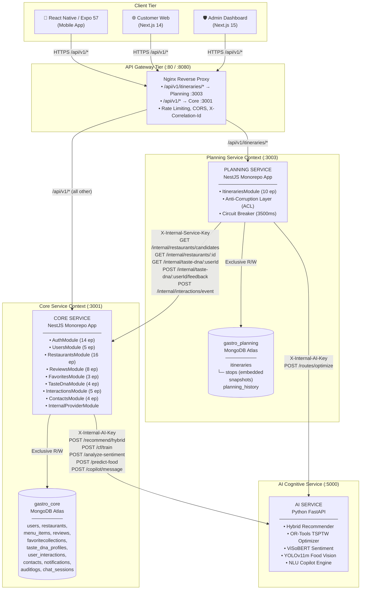
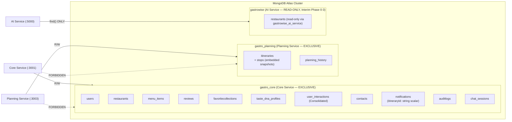
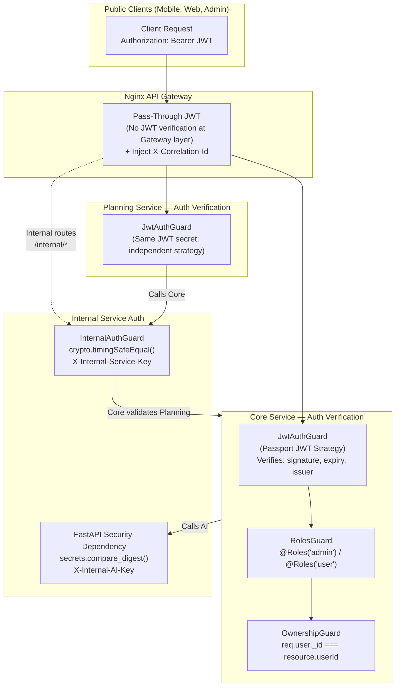
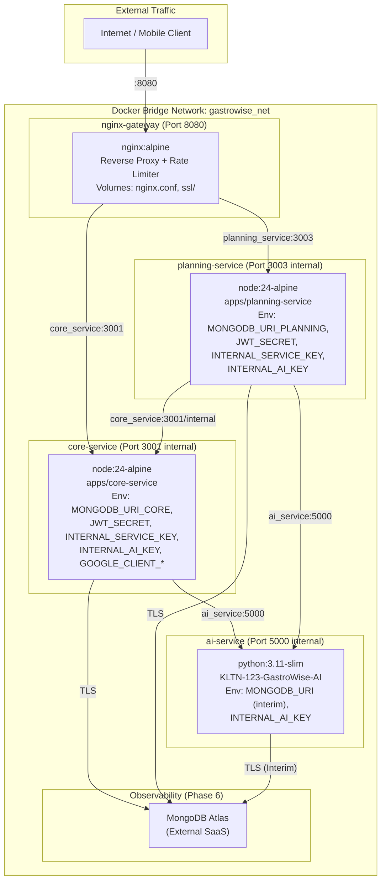

# GASTROWISE — MICROSERVICES ARCHITECTURE VALIDATION REPORT

**Document:** `docs/migration/ARCHITECTURE_VALIDATION_REPORT.md`  
**Repository:** [KLTN-123-GastroWise-BE](https://github.com/maanxx/KLTN-123-GastroWise-BE)  
**Author:** Senior Software Architect & Backend Tech Lead  
**Validation Date:** November 20, 2026  
**Status:** ✅ ARCHITECTURE VALIDATED — READY FOR PHASE 1 IMPLEMENTATION  
**Evidence Base:** 100% source-code-verified findings from `BACKEND_AUDIT.md` (Commit `f6bc66f`)

> [!IMPORTANT]
> This document constitutes the official architectural sign-off for the GastroWise Microservices target design. All decisions are grounded in actual source code evidence. No code has been modified during this validation phase.

---

## TABLE OF CONTENTS

1. [Executive Validation Summary](#1-executive-validation-summary)
2. [Final Service Responsibility Matrix](#2-final-service-responsibility-matrix)
3. [Service Dependency Diagram](#3-service-dependency-diagram)
4. [Database Ownership Diagram](#4-database-ownership-diagram)
5. [API Routing Plan](#5-api-routing-plan)
6. [Internal Communication Contract](#6-internal-communication-contract)
7. [Security Architecture](#7-security-architecture)
8. [Deployment Architecture](#8-deployment-architecture)
9. [Recommended Folder Structures](#9-recommended-folder-structures)
10. [Unresolved Architectural Decisions (ADRs)](#10-unresolved-architectural-decisions-adrs)
11. [Pre-Implementation Readiness Checklist](#11-pre-implementation-readiness-checklist)

---

## 1. EXECUTIVE VALIDATION SUMMARY

### 1.1. Validation Verdict

| Validation Dimension | Verdict | Evidence |
| :--- | :---: | :--- |
| Service boundaries are domain-driven, not folder-split | ✅ PASS | Core = Catalog + Identity domain; Planning = Journey domain. Genuine bounded contexts. |
| Planning Service isolation is achievable | ✅ PASS | All 3 coupling points in `itineraries.service.ts` (lines 257, 555, 841) can be replaced by ACL REST calls. |
| Database separation is safe | ✅ PASS | No ORM-level cross-collection join exists that cannot be replaced by snapshot value objects. |
| AI Service integration path is realistic | ✅ PASS | Interim DB-read model (Phase 0–3) is proven operational (178 restaurants loaded, TF-IDF verified). |
| Nginx Gateway routing is complete | ✅ PASS | 70 endpoints fully mapped; no ambiguous route overlap after itinerary prefix isolation. |
| Security defects are classified and actionable | ✅ PASS | 4 P0 defects documented with line evidence; implementation prompts written. |
| Shared library scope is bounded | ✅ PASS | `libs/shared` restricted to pure interfaces, enums, and math utilities — zero Mongoose imports. |

### 1.2. Known Pre-Existing Defects

The following **P0 defects** exist in the current monolith and **must be remediated during the migration phases**, not deferred:

| ID | Defect | File | Lines | Phase to Fix |
| :--- | :--- | :--- | :---: | :---: |
| P0-001 | AI router 404 mismatch (`/v1/recommendation/...` vs `/recommend/...`) | `restaurants.service.ts` | 448, 547, 969 | Phase 2 |
| P0-002 | Reviews BOLA — missing `JwtAuthGuard` on POST, PATCH, DELETE | `reviews.controller.ts` | 19, 48, 55, 58 | Phase 2 |
| P0-003 | Interaction matrix unauthenticated data exposure | `interactions.controller.ts` | 67 | Phase 2 |
| P0-004 | AI mutual auth missing (`allow_origins=["*"]`, no `X-Internal-AI-Key`) | `main.py` | — | Phase 4 |

---

## 2. FINAL SERVICE RESPONSIBILITY MATRIX

### 2.1. Responsibility Allocation by Bounded Context

| Module (Monolith) | NestJS Controller | Endpoints | Bounded Context | Target Service | Target Port | Target DB |
| :--- | :--- | :---: | :--- | :---: | :---: | :---: |
| `AuthModule` | `auth.controller.ts` | 14 | Identity & Access | **Core Service** | 3001 | `gastro_core` |
| `UsersModule` | `users.controller.ts` | 5 | User Profiles & RBAC | **Core Service** | 3001 | `gastro_core` |
| `RestaurantsModule` | `restaurants.controller.ts` | 16 | Culinary Catalog & Menus | **Core Service** | 3001 | `gastro_core` |
| `ReviewsModule` | `reviews.controller.ts` | 8 | Social Proof & Sentiment | **Core Service** | 3001 | `gastro_core` |
| `FavoritesModule` | `favorites.controller.ts` | 3 | User Bookmarks | **Core Service** | 3001 | `gastro_core` |
| `TasteDnaModule` | `taste-dna.controller.ts` | 4 | Flavor Preference Profiling | **Core Service** | 3001 | `gastro_core` |
| `InteractionsModule` | `interactions.controller.ts` | 5 | Behavioral Telemetry | **Core Service** | 3001 | `gastro_core` |
| `ContactsModule` | `contacts.controller.ts` | 4 | Inquiry & CRM | **Core Service** | 3001 | `gastro_core` |
| **`ItinerariesModule`** | `itineraries.controller.ts` | **10** | Journey & Route Planning | **Planning Service** | 3003 | `gastro_planning` |
| `AppModule` | `app.controller.ts` | 1 | Global Health Probe | Shared / Gateway | — | — |

**Total Public Endpoints: 70**
- Core Service owns: **60 endpoints**
- Planning Service owns: **10 endpoints**

### 2.2. Internal API Responsibility (Core Service as Provider)

| Internal Endpoint | HTTP Method | Consumer | Purpose |
| :--- | :---: | :---: | :--- |
| `/internal/restaurants/candidates` | `GET` | Planning Service | Venue candidate snapshots for tour generation |
| `/internal/restaurants/:id` | `GET` | Planning Service | Single venue detail snapshot |
| `/internal/taste-dna/:userId` | `GET` | Planning Service | 6-D flavor vector for personalization |
| `/internal/taste-dna/:userId/feedback` | `POST` | Planning Service | EMA adjustment on tour completion |
| `/internal/interactions/event` | `POST` | Planning Service | Non-blocking tour telemetry ingestion |

### 2.3. AI Service Capability Registry

| AI Capability | Python FastAPI Route | Caller(s) | Algorithm |
| :--- | :--- | :--- | :--- |
| Hybrid Recommendation | `/recommend/hybrid` | Core Service | Taste DNA Cosine + SVD CF + Context Boost |
| CF Model Training | `/cf/train` | Core Service | SVD Matrix Factorization (Surprise lib) |
| Sentiment Analysis | `/analyze-sentiment` | Core Service | ViSoBERT Vietnamese BERT |
| Food Vision | `/predict-food` | Core Service | YOLOv11m + CLAHE preprocessing |
| NLU Copilot | `/copilot/message` | Core Service | Intent + slot-fill dialogue engine |
| Route Optimization | `/routes/optimize` | Planning Service | OR-Tools TSPTW solver |

> [!NOTE]
> The AI Service is a **pure computation engine** — it owns no long-lived state, no user sessions, and no authoritative data. It is called synchronously by NestJS services and returns algorithm results.

---

## 3. SERVICE DEPENDENCY DIAGRAM



> [!NOTE]
> Arrow direction = HTTP caller → HTTP provider. The Planning Service is a **consumer** of Core's internal API. It never writes to Core's database directly.

---

## 4. DATABASE OWNERSHIP DIAGRAM



### 4.1. Cross-Boundary Reference Resolution Plan

| Monolith Cross-Boundary Reference | Current Implementation | Target Resolution |
| :--- | :--- | :--- |
| `ItineraryStop.restaurant_id` → `Restaurant` | `@Prop({ ref: 'Restaurant' })` with Mongoose `populate()` | **Snapshot Value Object** — store `restaurant_name`, `restaurant_lat`, `restaurant_lng` as scalars at creation time |
| `Notification.itineraryId` → `Itinerary` | `@Prop({ type: Types.ObjectId, ref: 'Itinerary' })` | **String scalar** — store `itineraryId: string`; remove `ref` from `@Prop`; resolve display client-side |
| `UserInteraction` duplicate schema | Dual `@Schema({ collection: 'user_interactions' })` | **Deprecate** `users/schemas/user-interaction.schema.ts`; consolidate on `interactions/schemas/interaction.schema.ts` |

> [!CAUTION]
> The AI Service's read-only access to `gastrowise.restaurants` via `gastrowise_ai_service` user is a **temporary interim state only**. ADR-05 mandates migration to Core REST candidate ingestion in Phase 4. Do NOT normalize AI DB access to a permanent pattern.

---

## 5. API ROUTING PLAN

### 5.1. Nginx Gateway Routing Strategy

The Nginx API Gateway resolves the Mobile API prefix inconsistency (`EXPO_PUBLIC_API_URL` includes `/api/v1`; monolith `main.ts` has no global prefix) and unifies all client traffic through a single entry point.

**Core routing rules (priority order):**

| Priority | Location Prefix | Proxy Target | Service | Notes |
| :---: | :--- | :--- | :---: | :--- |
| 1 | `/api/v1/itineraries/` | `http://planning-service:3003/api/v1/itineraries/` | Planning | Most specific match first |
| 2 | `/api/v1/` | `http://core-service:3001/api/v1/` | Core | All remaining paths |
| 3 | `/health` | Local Nginx handler | Gateway | Liveness probe |

**Nginx configuration excerpt (conceptual):**
```nginx
upstream core_service {
    server core-service:3001;
    keepalive 64;
}

upstream planning_service {
    server planning-service:3003;
    keepalive 32;
}

server {
    listen 8080;

    # Inject correlation ID for distributed tracing
    add_header X-Correlation-Id $request_id always;

    # Planning Service: itineraries (most specific — must come first)
    location /api/v1/itineraries/ {
        proxy_pass http://planning_service;
        proxy_set_header X-Correlation-Id $request_id;
        proxy_set_header Authorization $http_authorization;
        proxy_read_timeout 30s;
    }

    # Core Service: all other API routes
    location /api/v1/ {
        proxy_pass http://core_service;
        proxy_set_header X-Correlation-Id $request_id;
        proxy_set_header Authorization $http_authorization;
        proxy_read_timeout 30s;
    }

    # Backward-compatible rewrite: legacy prefix-less routes → /api/v1/
    location ~ ^/(auth|restaurants|reviews|users|favorites|taste-dna|interactions|contacts|itineraries)/ {
        rewrite ^/(.*)$ /api/v1/$1 last;
    }

    # Health check
    location /health {
        return 200 '{"status":"UP","service":"nginx-gateway"}' ;
        add_header Content-Type application/json;
    }

    client_max_body_size 10M;  # Avatar uploads
}
```

### 5.2. Mobile API Prefix Consistency Fix (P1)

Both NestJS apps must register the global prefix:
```typescript
// apps/core-service/src/main.ts AND apps/planning-service/src/main.ts
app.setGlobalPrefix('api/v1');
```
This aligns both services with `EXPO_PUBLIC_API_URL=http://...:3001/api/v1` without requiring any mobile client code changes.

---

## 6. INTERNAL COMMUNICATION CONTRACT

### 6.1. Planning Service → Core Service

All requests from Planning Service to Core Service must include the header:
```
X-Internal-Service-Key: <INTERNAL_SERVICE_KEY_SECRET>
X-Correlation-Id: <forwarded-from-inbound-request>
```

#### Contract 1: Restaurant Candidate Retrieval

```
GET /internal/restaurants/candidates
Host: core-service:3001
X-Internal-Service-Key: <secret>
X-Correlation-Id: req_<uuid>

Query Parameters:
  - tags: string[]        (optional) — filter by cuisine/vibe tags
  - lat: number           (optional) — centroid latitude for geospatial sort
  - lng: number           (optional) — centroid longitude for geospatial sort
  - radius_km: number     (optional, default: 5) — bounding radius
  - limit: number         (optional, default: 50)

Response 200 OK:
{
  "candidates": [
    {
      "restaurant_id": "string",         // Opaque ObjectId as string
      "restaurant_name": "string",
      "address": "string",
      "lat": number,
      "lng": number,
      "rating": number,                  // 0.0 – 5.0 (normalized)
      "cuisine_tags": string[],
      "price_range": "budget" | "mid" | "premium",
      "open_hours": { "open": "HH:MM", "close": "HH:MM" },
      "estimated_dining_duration_mins": number
    }
  ],
  "total": number
}

Error 401 Unauthorized:
{ "error": "INTERNAL_AUTH_FAILED" }

Error 500 Internal Server Error:
{ "error": "CORE_SERVICE_ERROR", "correlationId": "req_<uuid>" }
```

#### Contract 2: Single Restaurant Snapshot

```
GET /internal/restaurants/:restaurantId
Host: core-service:3001
X-Internal-Service-Key: <secret>

Response 200 OK: (single candidate object as above)
Error 404 Not Found: { "error": "RESTAURANT_NOT_FOUND" }
Error 401 Unauthorized: { "error": "INTERNAL_AUTH_FAILED" }
```

#### Contract 3: Taste DNA Vector Retrieval

```
GET /internal/taste-dna/:userId
Host: core-service:3001
X-Internal-Service-Key: <secret>

Response 200 OK:
{
  "userId": "string",
  "vector": {
    "sweet": number,     // 0.0 – 1.0
    "sour": number,
    "salty": number,
    "spicy": number,
    "bitter": number,
    "umami": number
  },
  "confidence": number,  // 0.0 – 1.0 (quiz completion level)
  "lastUpdated": "ISO8601"
}

Error 404 Not Found: { "error": "TASTE_DNA_NOT_FOUND" }
  → Planning Service handles this gracefully by using equal-weight vector [0.5, 0.5, 0.5, 0.5, 0.5, 0.5]
```

#### Contract 4: Taste DNA EMA Feedback

```
POST /internal/taste-dna/:userId/feedback
Host: core-service:3001
X-Internal-Service-Key: <secret>
Content-Type: application/json

Body:
{
  "completedItineraryId": "string",
  "restaurantIds": string[],     // Restaurants visited during tour
  "satisfaction_score": number   // 1–5 user rating of tour
}

Response 200 OK: { "updated": true }
Response 404 Not Found: { "error": "USER_NOT_FOUND" }
```

#### Contract 5: Interaction Event Ingestion

```
POST /internal/interactions/event
Host: core-service:3001
X-Internal-Service-Key: <secret>
Content-Type: application/json

Body:
{
  "userId": "string",
  "restaurantId": "string",
  "eventType": "tour_visit" | "tour_completion" | "tour_abandonment",
  "itineraryId": "string",
  "timestamp": "ISO8601",
  "dwellTimeMs": number    // optional
}

Response 202 Accepted: { "queued": true }
  → Fire-and-forget; Planning does not block on this call.
```

### 6.2. Core / Planning → AI Service

All requests to the AI Service must include:
```
X-Internal-AI-Key: <INTERNAL_AI_KEY_SECRET>
X-Correlation-Id: <forwarded>
Content-Type: application/json
```

> [!IMPORTANT]
> **ADR-07 Fix Required (P0-001):** Backend currently calls `/v1/recommendation/recommend/hybrid` but FastAPI mounts at `/recommend/hybrid`. All 5 AI endpoint calls in `restaurants.service.ts` (lines 448, 547, 969) must be corrected during Phase 2.

#### AI Contract: Hybrid Recommendation

```
POST http://ai-service:5000/recommend/hybrid
X-Internal-AI-Key: <secret>

Body:
{
  "user_id": "string",
  "taste_dna": { "sweet": 0.8, "spicy": 0.3, ... },
  "context": {
    "time_of_day": "lunch" | "dinner" | "breakfast",
    "weather": "sunny" | "rainy" | "cloudy",
    "group_size": number
  },
  "limit": number  // default 10
}

Response 200 OK:
{
  "recommendations": [
    { "restaurant_id": "string", "score": number, "explanation": "string" }
  ],
  "algorithm": "hybrid_v2",
  "fallback": false
}
```

#### AI Contract: Route Optimization

```
POST http://ai-service:5000/routes/optimize
X-Internal-AI-Key: <secret>

Body:
{
  "restaurants": [
    { "id": "string", "lat": number, "lng": number,
      "open": "HH:MM", "close": "HH:MM", "duration_mins": number }
  ],
  "start_lat": number,
  "start_lng": number,
  "start_time": "HH:MM",
  "routing_mode": "walking" | "driving" | "transit",
  "budget_vnd": number
}

Response 200 OK:
{
  "ordered_stops": [{ "id": "string", "arrival": "HH:MM", "departure": "HH:MM",
                      "transit_mins": number, "distance_km": number }],
  "total_distance_km": number,
  "total_duration_mins": number,
  "solver": "ortools_tsptw"
}

Timeout threshold: 3,500ms → Planning Service trips Circuit Breaker
Fallback: Greedy nearest-neighbor heuristic (internal Planning logic)
```

### 6.3. Circuit Breaker Configuration

| Calling Service | Target | Timeout | Failure Threshold | Fallback Strategy |
| :---: | :--- | :---: | :---: | :--- |
| Core Service | AI `/recommend/hybrid` | 3,500ms | 3 consecutive failures | `getFallbackRecommendations()` — MongoDB top-rating sort |
| Planning Service | AI `/routes/optimize` | 3,500ms | 3 consecutive failures | Gastronomic Greedy Heuristic (internal) |
| Planning Service | Core `/internal/*` | 2,000ms | 2 consecutive failures | Return 503 to gateway; Surface error to user |

---

## 7. SECURITY ARCHITECTURE

### 7.1. Authentication & Authorization Model



### 7.2. Secrets Management

| Secret | Variable Name | Scope | Storage |
| :--- | :--- | :--- | :--- |
| JWT signing key | `JWT_SECRET` | Core + Planning (shared) | Docker secret / `.env` (never committed) |
| Internal service key | `INTERNAL_SERVICE_KEY` | Core + Planning (shared) | Docker secret / `.env` |
| Internal AI key | `INTERNAL_AI_KEY` | Core + Planning + AI (shared) | Docker secret / `.env` |
| MongoDB URI (Core) | `MONGODB_URI_CORE` | Core Service only | Docker secret / `.env` |
| MongoDB URI (Planning) | `MONGODB_URI_PLANNING` | Planning Service only | Docker secret / `.env` |
| MongoDB URI (AI, interim) | `MONGODB_URI` | AI Service only | Docker secret / `.env` |
| Google OAuth credentials | `GOOGLE_CLIENT_ID`, `GOOGLE_CLIENT_SECRET` | Core Service only | Docker secret / `.env` |

> [!CAUTION]
> **Never store any secret in source code, committed `.env` files, or Docker image layers.** Inject secrets at runtime through Docker Compose `secrets:` or environment variable injection from a secrets vault.

### 7.3. P0 Security Remediations (Must Fix in Phase 2)

#### Review Endpoint Authorization Fix (P0-002)

Current state in `src/reviews/reviews.controller.ts`:
```typescript
// CURRENT — BROKEN: No guards on write endpoints
@Post()
create(@Body() dto, @Headers('x-user-id') userId: string) { ... }

@Delete(':id')
remove(@Param('id') id: string) { ... }

@Patch(':id')
update(@Param('id') id: string, @Body() dto) { ... }

@Post('migrate-sentiment')
migrateSentiment() { ... }
```

Target state (Core Service):
```typescript
// TARGET — HARDENED
@UseGuards(JwtAuthGuard)
@Post()
create(@Body() dto, @Request() req) {
  return this.reviewsService.create(dto, req.user._id);  // Extract from token
}

@UseGuards(JwtAuthGuard, ReviewOwnerGuard)
@Delete(':id')
remove(@Param('id') id: string, @Request() req) { ... }

@UseGuards(JwtAuthGuard, ReviewOwnerGuard)
@Patch(':id')
update(@Param('id') id: string, @Body() dto, @Request() req) { ... }

@UseGuards(JwtAuthGuard, RolesGuard)
@Roles('admin')
@Post('migrate-sentiment')
migrateSentiment() { ... }
```

#### Interaction Matrix Authorization Fix (P0-003)

```typescript
// CURRENT — BROKEN: Unauthenticated matrix export
@Get('matrix')
getMatrix() { ... }

// TARGET — HARDENED
@UseGuards(JwtAuthGuard, RolesGuard)
@Roles('admin')
@Get('matrix')
getMatrix() { ... }
```

#### AI Mutual Auth Implementation (P0-004)

FastAPI target (`app/core/auth.py`):
```python
from fastapi.security.api_key import APIKeyHeader
import secrets, os

API_KEY_HEADER = APIKeyHeader(name="X-Internal-AI-Key", auto_error=True)

async def verify_internal_key(api_key: str = Security(API_KEY_HEADER)):
    expected = os.environ["INTERNAL_AI_KEY"].encode()
    provided = api_key.encode()
    if not secrets.compare_digest(expected, provided):
        raise HTTPException(status_code=403, detail="INTERNAL_AUTH_FAILED")
    return True
```

### 7.4. InternalAuthGuard Implementation (NestJS)

```typescript
// libs/shared/src/guards/internal-auth.guard.ts
import { CanActivate, ExecutionContext, Injectable, UnauthorizedException } from '@nestjs/common';
import { timingSafeEqual } from 'crypto';

@Injectable()
export class InternalAuthGuard implements CanActivate {
  canActivate(context: ExecutionContext): boolean {
    const request = context.switchToHttp().getRequest();
    const provided = request.headers['x-internal-service-key'];
    const expected = process.env.INTERNAL_SERVICE_KEY;

    if (!provided || !expected) throw new UnauthorizedException('INTERNAL_AUTH_MISSING');

    const aBuffer = Buffer.from(provided);
    const bBuffer = Buffer.from(expected);

    if (aBuffer.length !== bBuffer.length) throw new UnauthorizedException('INTERNAL_AUTH_FAILED');
    if (!timingSafeEqual(aBuffer, bBuffer)) throw new UnauthorizedException('INTERNAL_AUTH_FAILED');

    return true;
  }
}
```

---

## 8. DEPLOYMENT ARCHITECTURE

### 8.1. Docker Compose Topology



### 8.2. Docker Compose Service Definitions (Phase 6 Target)

```yaml
# docker-compose.yml (Target — Phase 6)
version: "3.9"

networks:
  gastrowise_net:
    driver: bridge

services:
  nginx-gateway:
    image: nginx:1.27-alpine
    ports: ["8080:8080"]
    volumes:
      - ./nginx/nginx.conf:/etc/nginx/nginx.conf:ro
    depends_on: [core-service, planning-service]
    networks: [gastrowise_net]

  core-service:
    build:
      context: .
      dockerfile: apps/core-service/Dockerfile
    expose: ["3001"]
    env_file: .env.core
    healthcheck:
      test: ["CMD", "wget", "-qO-", "http://localhost:3001/health"]
      interval: 30s
      timeout: 5s
      retries: 3
    networks: [gastrowise_net]

  planning-service:
    build:
      context: .
      dockerfile: apps/planning-service/Dockerfile
    expose: ["3003"]
    env_file: .env.planning
    depends_on:
      core-service:
        condition: service_healthy
    healthcheck:
      test: ["CMD", "wget", "-qO-", "http://localhost:3003/health"]
      interval: 30s
      timeout: 5s
      retries: 3
    networks: [gastrowise_net]

  ai-service:
    build:
      context: ../KLTN-123-GastroWise-AI
      dockerfile: Dockerfile
    expose: ["5000"]
    env_file: ../KLTN-123-GastroWise-AI/.env
    healthcheck:
      test: ["CMD", "curl", "-f", "http://localhost:5000/health"]
      interval: 30s
      timeout: 10s
      retries: 3
    networks: [gastrowise_net]
```

---

## 9. RECOMMENDED FOLDER STRUCTURES

### 9.1. NestJS Monorepo Root Structure

```
KLTN-123-GastroWise-BE/
├── apps/
│   ├── core-service/                  # Core Service application
│   │   ├── src/
│   │   │   ├── main.ts               # Bootstrap — port 3001, global prefix /api/v1
│   │   │   ├── app.module.ts         # Root module (imports all Core modules)
│   │   │   ├── auth/                 # Migrated from monolith src/auth/
│   │   │   ├── users/                # Migrated from monolith src/users/
│   │   │   ├── restaurants/          # Migrated + AI route URL fixed
│   │   │   ├── reviews/              # Migrated + JwtAuthGuard added (P0-002)
│   │   │   ├── favorites/
│   │   │   ├── taste-dna/
│   │   │   ├── interactions/         # matrix endpoint guarded (P0-003)
│   │   │   ├── contacts/
│   │   │   └── internal/             # NEW: InternalProviderModule
│   │   │       ├── internal.module.ts
│   │   │       ├── internal-restaurants.controller.ts
│   │   │       ├── internal-taste-dna.controller.ts
│   │   │       └── internal-interactions.controller.ts
│   │   ├── Dockerfile
│   │   └── tsconfig.app.json
│   │
│   └── planning-service/             # Planning Service application
│       ├── src/
│       │   ├── main.ts               # Bootstrap — port 3003, global prefix /api/v1
│       │   ├── app.module.ts
│       │   ├── itineraries/          # Migrated from monolith src/itineraries/
│       │   │   ├── itineraries.module.ts
│       │   │   ├── itineraries.controller.ts
│       │   │   ├── itineraries.service.ts   # Dependencies replaced by ACL calls
│       │   │   └── schemas/
│       │   │       ├── itinerary.schema.ts  # Snapshot value objects (no Restaurant ref)
│       │   │       └── planning-history.schema.ts
│       │   ├── acl/                  # Anti-Corruption Layer
│       │   │   ├── acl.module.ts
│       │   │   ├── core-api.client.ts   # HttpService wrapper for /internal/* calls
│       │   │   └── ai-api.client.ts     # HttpService wrapper for AI calls
│       │   └── health/
│       │       └── health.controller.ts
│       ├── Dockerfile
│       └── tsconfig.app.json
│
├── libs/
│   └── shared/                       # Zero Mongoose — pure contracts only
│       └── src/
│           ├── contracts/
│           │   ├── core.contract.ts         # RestaurantCandidateDto, TasteDnaDto, etc.
│           │   ├── planning.contract.ts     # ItineraryStopSnapshot
│           │   └── ai.contract.ts           # HybridRecommendRequest, RouteOptimizeRequest
│           ├── enums/
│           │   ├── roles.enum.ts
│           │   ├── routing-mode.enum.ts
│           │   └── itinerary-status.enum.ts
│           ├── guards/
│           │   └── internal-auth.guard.ts   # InternalAuthGuard (timingSafeEqual)
│           └── utils/
│               └── geo.utils.ts             # Haversine distance calculation
│
├── src/                              # Monolith (preserved until Phase 5 cutover)
├── nginx/
│   └── nginx.conf                   # API Gateway configuration
├── docs/                             # Architecture, migration, and progress documentation
├── nest-cli.json                     # Monorepo configuration
├── tsconfig.json                     # Path alias @shared/* → libs/shared/src/*
├── package.json
└── docker-compose.yml               # Phase 6 target
```

### 9.2. AI Service Structure (Preserved, Hardened)

```
KLTN-123-GastroWise-AI/
├── app/
│   ├── api/v1/
│   │   ├── router.py                # Route registrations (corrected paths)
│   │   └── endpoints/
│   │       ├── recommendation.py    # POST /recommend/hybrid
│   │       ├── cf.py                # POST /cf/train
│   │       ├── sentiment.py         # POST /analyze-sentiment
│   │       ├── vision.py            # POST /predict-food
│   │       ├── copilot.py           # POST /copilot/message
│   │       └── routes.py            # POST /routes/optimize
│   ├── core/
│   │   ├── auth.py                  # NEW: verify_internal_key dependency (P0-004)
│   │   ├── nutrition_data.py        # Nutrition dictionary (decoupled from cv2)
│   │   ├── nlu_service.py           # NLU copilot (fixed budget regex)
│   │   └── vision_service.py
│   ├── db/
│   │   └── mongo.py                 # normalize_rating() verified (5-pt scale)
│   ├── config.py                    # .env auto-load
│   └── main.py                      # FastAPI app (CORS hardened in Phase 4)
├── Dockerfile
└── requirements.txt
```

---

## 10. UNRESOLVED ARCHITECTURAL DECISIONS (ADRs)

### ADR-05: AI Service Database Access Strategy

**Question:** Should AI Service continue reading MongoDB directly (interim) or migrate to Core REST candidate ingestion (target)?

| Option | Description | Risk |
| :--- | :--- | :--- |
| A — Interim Only (Phases 0–3) | Read-only `find` on `restaurants` via `gastrowise_ai_service` | Acceptable short-term coupling; must be removed in Phase 4 |
| **B — Two-Stage Evolution (Recommended ✅)** | Interim DB-read in Phases 0–3; full REST ingestion in Phase 4 | Phased risk; maintains velocity while delivering final clean architecture |
| C — Pure REST from Phase 1 | Core streams candidates immediately | High refactoring cost on AI side while other work is in progress |

> **Recommendation: Option B.** The `gastrowise_ai_service` MongoDB user is already provisioned, least-privilege, read-only. Use it for Phases 0–3. Phase 4 implements Core's `/internal/restaurants/candidates` endpoint which AI will then consume. This is the lowest-risk path that still delivers the target architecture.

---

### ADR-06: Database Split Migration Strategy

**Question:** How to safely split `gastrowise` → `gastro_core` + `gastro_planning`?

| Phase | Action | Validation |
| :--- | :--- | :--- |
| 1 | `mongodump` full backup of `gastrowise` | Verify dump file integrity with `mongorestore --dryRun` |
| 2 | Use `$merge` aggregation to copy `itineraries` → `gastro_planning.itineraries` | Document count parity check: `db.itineraries.countDocuments()` = same in both |
| 3 | Run Planning Service against `gastro_planning`; dual-write for 1 week | Compare query results between old and new DB in staging |
| 4 | Decommission `gastrowise.itineraries` only after Core cutover to `gastro_core` | Rollback: `mongorestore` from dump; switch env var; redeploy |

> **Recommendation:** Implement a `migration-lock` flag in both databases. If parity fails, halt automatically and restore from dump without manual intervention.

---

### ADR-07: AI Router URL Mismatch Resolution

**Question:** Backend calls `/v1/recommendation/recommend/hybrid`; FastAPI mounts at `/recommend/hybrid`. How to fix?

| Option | Description | Risk |
| :--- | :--- | :--- |
| A — Fix backend URLs only | Update `restaurants.service.ts` lines 448, 547, 969 to drop `/v1/recommendation` prefix | Zero AI-side change; cleanest fix; ✅ |
| **B — Dual-route FastAPI mount (Recommended ✅)** | Mount both old and new paths in `router.py`; fix backend in parallel | Zero client breakage during transition; allows gradual cutover |
| C — Fix AI router only | Add `/v1/recommendation/` prefix to FastAPI | Requires backend to remain broken until AI deploys |

> **Recommendation: Option B.** Add backward-compatible dual routes in FastAPI (`/v1/recommendation/recommend/hybrid` AND `/recommend/hybrid`) in Phase 2. Fix backend URLs in the same phase. Remove legacy routes in Phase 4. This prevents 100% recommendation failure during the deployment transition window.

**FastAPI dual-mount implementation:**
```python
# app/api/v1/router.py
app.include_router(recommendation_router, prefix="/recommend")
app.include_router(recommendation_router, prefix="/v1/recommendation/recommend")  # Interim compat
```

---

### ADR-08: Review Endpoint Access Control Policy

**Question:** What access control model should Reviews use for PATCH/DELETE?

| Option | Description | Risk |
| :--- | :--- | :--- |
| **A — Owner + Admin pattern (Recommended ✅)** | Owner can edit/delete own reviews; Admin can edit/delete any review | Standard pattern; aligns with User RBAC already in system |
| B — Admin only | Only Admin can modify reviews | Too restrictive; degrades UX |
| C — Owner only | Only review author can delete | Cannot handle abusive content moderation |

> **Recommendation: Option A.** Implement `ReviewOwnerGuard` that checks `req.user._id === review.userId || req.user.roles.includes('admin')`. Use `crypto.timingSafeEqual()` equivalently for ID comparison to prevent timing attacks.

---

### ADR-09 (NEW): `Notification.itineraryId` Cross-Boundary Fix

**Question:** `notifications.itineraryId` currently has `ref: 'Itinerary'`. When Itineraries move to `gastro_planning`, Mongoose `populate()` will fail.

| Option | Description | Risk |
| :--- | :--- | :--- |
| **A — String scalar (Recommended ✅)** | Change `@Prop({ type: Types.ObjectId, ref: 'Itinerary' })` to `@Prop({ type: String })`. Resolve itinerary display client-side via `/api/v1/itineraries/:id` | No data migration needed; cleanest boundary |
| B — Notification event over HTTP | Planning Service POSTs notification event to Core when itinerary status changes | Additional internal contract complexity |
| C — Keep ref, never populate | Never call `populate('itineraryId')`; treat as opaque string | Risk: future developer adds `populate()` call and breaks in production |

> **Recommendation: Option A.** Change `ref: 'Itinerary'` to remove the `ref` from `@Prop`. Store only `itineraryId: string`. Mobile/Web resolves display by calling `GET /api/v1/itineraries/:id` separately. This requires a one-line schema change and no data migration.

---

## 11. PRE-IMPLEMENTATION READINESS CHECKLIST

Before starting Phase 1 (Monorepo Foundation), confirm:

| Checklist Item | Status |
| :--- | :---: |
| Audit completed and all findings evidence-based | ✅ Done |
| All 70 endpoints mapped to target services | ✅ Done |
| All 13 schemas classified by service boundary | ✅ Done |
| Cross-boundary coupling points identified with file/line evidence | ✅ Done |
| All 4 P0 defects documented with implementation prompts | ✅ Done |
| All 5 ADRs resolved with one recommended option each | ✅ Done |
| DB split strategy documented (ADR-06) | ✅ Done |
| Shared library scope bounded (zero Mongoose imports) | ✅ Confirmed |
| Monolith `src/` preserved for Phase 1–4 coexistence | ✅ Confirmed |
| Git branching strategy defined (`feat/milestone-N-*`) | ✅ Confirmed |
| `.env` files excluded from commits (`.gitignore` verified) | ✅ Confirmed |
| Implementation prompts (`docs/implementation-prompts/`) reviewed | ✅ Written |
| **ARCHITECTURE VALIDATION COMPLETE — AWAITING PHASE 1 APPROVAL** | 🟡 Pending |

> [!IMPORTANT]
> **This document constitutes the final architecture validation gate.** No Phase 1 implementation work should begin until this report has been reviewed and approved by the development team. After approval, proceed with `docs/migration/MIGRATION_EXECUTION_PLAN.md` Phase 1 task breakdown.

---

*Document end. Generated by Senior Software Architect after full source-code audit of `KLTN-123-GastroWise-BE` commit `f6bc66f`. All findings are evidence-based.*

