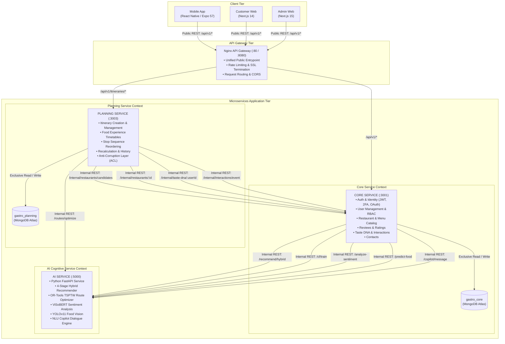

# GASTROWISE – MICROSERVICES TARGET ARCHITECTURE SPECIFICATION

**Document:** `docs/migration/MICROSERVICES_TARGET_ARCHITECTURE.md`  
**Repository:** [KLTN-123-GastroWise-BE](https://github.com/maanxx/KLTN-123-GastroWise-BE)  
**Author:** Senior Software Architect & Backend Tech Lead  
**Last Updated:** November 20, 2026  
**Status:** FORMALIZED TARGET DESIGN — READY FOR IMPLEMENTATION PHASING  

---

## 1. TARGET ARCHITECTURE TOPOLOGY

The target GastroWise system transitions from a single monolithic backend into an autonomous, distributed Microservices Architecture:



---

## 2. SERVICE BOUNDARIES & RESPONSIBILITIES

### 2.1. Core Service (`apps/core-service` :3001)
- **Primary Domain:** Culinary Catalog, Identity, Engagement & Social Proof.
- **Key Capabilities:**
  - Complete user lifecycle, registration, authentication, RBAC, 2FA, password recovery.
  - Full restaurant and menu catalog CRUD, geospatial index queries (`$near`), image dish search orchestration.
  - Review moderation, community feedback, sentiment aggregation.
  - Taste DNA 6-dimensional flavor profiling, preference quiz scoring.
  - User interaction telemetry ingestion, matrix export for CF training.
- **Database Ownership:** Exclusively owns database `gastro_core`.
- **Public Endpoints:** `/api/v1/auth/*`, `/api/v1/users/*`, `/api/v1/restaurants/*`, `/api/v1/reviews/*`, `/api/v1/favorites/*`, `/api/v1/taste-dna/*`, `/api/v1/interactions/*`, `/api/v1/contacts/*`.
- **Internal Provider Endpoints (Protected by `X-Internal-Service-Key`):**
  - `GET /internal/restaurants/candidates`: Supplies candidate venue snapshots for planning.
  - `GET /internal/restaurants/:id`: Supplies single venue detail snapshot.
  - `GET /internal/taste-dna/:userId`: Supplies 6-D taste vector for personalization.
  - `POST /internal/taste-dna/:userId/feedback`: Applies EMA adjustment upon tour completion.
  - `POST /internal/interactions/event`: Receives non-blocking tour telemetry.

---

### 2.2. Planning Service (`apps/planning-service` :3003)
- **Primary Domain:** Journey Planning, Scheduling & Gastronomic Route Optimization.
- **Key Capabilities:**
  - Multi-stop itinerary generation based on user prompt, budget, time windows, and transit modes.
  - Route timetable calculation (arrival times, dining durations, transit minutes, distance, CO2 savings).
  - Stop sequence reordering, dynamic recalculation when stops are added or removed.
  - Itinerary completion tracking and history.
  - Anti-Corruption Layer (ACL) translating foreign catalog DTOs into domain value objects.
- **Database Ownership:** Exclusively owns database `gastro_planning`.
- **Strict Boundary Rules:**
  - **ZERO direct database connection** to `gastro_core` or `gastrowise`.
  - **ZERO imports** of Core's schemas (`Restaurant`, `User`, `TasteDnaProfile`).
  - Stores immutable restaurant snapshots inside `itineraries.stops`.
- **Public Endpoints:** `/api/v1/itineraries/*`.

---

### 2.3. AI Microservice (Python FastAPI :5000)
- **Primary Domain:** Machine Learning, Cognitive Algorithms & Mathematical Optimization.
- **Key Capabilities:**
  - Google OR-Tools TSPTW (Traveling Salesperson Problem with Time Windows) route optimizer.
  - 4-Stage Hybrid Recommender (Taste DNA Cosine + SVD Collaborative Filtering + Context Boost).
  - ViSoBERT Vietnamese sentiment analysis and polarity scoring.
  - YOLOv11m computer vision dish recognition with CLAHE preprocessing.
  - NLU Copilot dialogue engine (intent classification and slot filling).
- **Communication:** Pure stateless computation over HTTP REST.
- **Interim vs Target State:**
  - *Interim (Phases 1–3):* Read-only `find` on `restaurants` via user `gastrowise_ai_service`.
  - *Target (Phase 4):* Zero direct database connection; Core streams candidates via REST.

---

### 2.4. API Gateway (Nginx :80 / :8080)
- **Primary Domain:** Edge Reverse Proxy, Request Routing & Client Facade.
- **Key Capabilities:**
  - Ingress traffic routing to Core (`/api/v1/*`) and Planning (`/api/v1/itineraries/*`).
  - Cross-Origin Resource Sharing (CORS) enforcement across Web, Admin, and Mobile origins.
  - Rate limiting and slow-client buffering.
  - `X-Correlation-Id` injection for distributed tracing across services.

---

## 3. DATABASE OWNERSHIP & DATA ISOLATION

To eliminate cross-database coupling, collections are divided strictly between services:

```
MongoDB Atlas Cluster
├── Database: gastro_core (Exclusive Owner: Core Service)
│   ├── users
│   ├── restaurants
│   ├── menu_items
│   ├── reviews
│   ├── favoritecollections
│   ├── taste_dna_profiles
│   ├── user_interactions (Consolidated)
│   ├── contacts
│   ├── notifications (itineraryId stored as string scalar)
│   ├── auditlogs
│   └── chat_sessions
│
└── Database: gastro_planning (Exclusive Owner: Planning Service)
    ├── itineraries
    │   └── stops (Embedded: Immutable Snapshot Value Objects)
    └── planning_history
```

### Snapshot Value Pattern for Itinerary Stops
In the monolith, `ItineraryStop` stored an ObjectId reference to `Restaurant`, calling `populate('restaurant_id')`. In the target microservice architecture, `ItineraryStop` stores immutable snapshot value objects:
```typescript
export class ItineraryStopSnapshot {
  stop_id: string;
  order_index: number;
  restaurant_id: string;        // Opaque foreign identifier
  restaurant_name: string;      // Snapshot at creation time
  restaurant_lat: number;       // Snapshot coordinate
  restaurant_lng: number;       // Snapshot coordinate
  meal_type: string;
  arrival_time: string;
  departure_time: string;
  dining_duration_mins: number;
  transit_time_mins: number;
  distance_to_next_km: number;
  estimated_cost: number;
  tags?: string;
}
```
**Architectural Benefit:** If a restaurant changes its name, menu, or closes, the user's historical itinerary remains geographically valid, accurate, and visually intact forever.

---

## 4. INTER-SERVICE COMMUNICATION & RESILIENCE PROTOCOLS

### 4.1. Distributed Tracing (`X-Correlation-Id`)
Gateway injects `X-Correlation-Id: req_<uuid>` if absent. Core, Planning, and AI forward this header in all downstream HTTP calls and include it in application log lines:
```text
[CorrelationId: req_7b9f...] [PlanningService] Calling AI Route Optimizer: /routes/optimize
```

### 4.2. Mutual Service Authentication
- **Planning $\rightarrow$ Core:** Header `X-Internal-Service-Key` verified by NestJS `InternalAuthGuard` using constant-time comparison (`crypto.timingSafeEqual`).
- **Core / Planning $\rightarrow$ AI:** Header `X-Internal-AI-Key` verified by FastAPI `Security(verify_internal_key)` using `secrets.compare_digest`.

### 4.3. Circuit Breaker & Fallback SLA
- If AI Service times out ($> 3,500\text{ ms}$) or fails:
  - Planning Service immediately trips Circuit Breaker and runs internal **Gastronomic Greedy Heuristic** (100% tour generation uptime).
  - Core Service trips Circuit Breaker and falls back to **MongoDB top-rating sort** (`getFallbackRecommendations()`).

