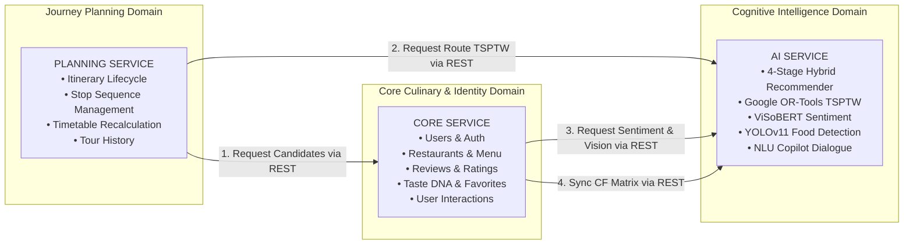

# GASTROWISE – MODULE & DATA OWNERSHIP SPECIFICATION (DDD BOUNDED CONTEXTS)
**Thesis:** Xây dựng hệ thống thông tin trải nghiệm ẩm thực thông minh (GastroWise)  
**Author:** Senior Software Architect & Tech Lead  
**Audit Date:** November 17, 2026  
**Status:** PHASE 0 COMPLETED — BOUNDED CONTEXTS FORMALIZED  

---

## 1. DOMAIN-DRIVEN DESIGN (DDD) BOUNDED CONTEXT OVERVIEW

To successfully migrate GastroWise from a Modular Monolith to an enterprise-grade Microservices Architecture without over-engineering, the system domain is decomposed into three distinct Bounded Contexts:



---

## 2. DETAILED SERVICE OWNERSHIP MATRIX

### 2.1. CORE SERVICE (`apps/core-service`)
- **Bounded Context:** Core Culinary, Identity & Engagement
- **Runtime:** Node.js v24+ / NestJS 11
- **Database Ownership:** `gastro_core` (MongoDB)
- **Primary Business Responsibilities:**
  1. User identity lifecycle: Registration, JWT login, token refresh rotation, Google OAuth, 2FA, password recovery.
  2. RBAC & Permissions: Enforcing `Admin`, `Owner`, `User` role authorization via `RolesGuard`.
  3. Restaurant catalog & spatial search: Managing restaurant venues, menu items, opening hours, pricing, and 2dsphere GeoJSON proximity queries (`GET /restaurants/nearby`).
  4. User engagement: Reviews creation, community ratings, favorite collections toggle, user contact inquiries.
  5. Personalization profiling: 6-D Taste DNA vector calibration and user behavioral interaction event ingestion (`POST /interactions/batch`).
- **Data Collections Owned:**
  - `users`
  - `restaurants`
  - `menu_items`
  - `reviews`
  - `favorite_collections`
  - `taste_dna_profiles`
  - `user_interactions`
  - `contacts`
  - `notifications`
  - `audit_logs`
- **Strict Boundary Rules:**
  - Core Service MUST NOT contain itinerary creation or route planning logic.
  - Core Service NEVER writes to the `itineraries` collection.
  - Core Service exposes clean REST APIs for Planning Service to query candidate restaurants and user taste vectors.

---

### 2.2. PLANNING SERVICE (`apps/planning-service`)
- **Bounded Context:** Journey Planning & Route Optimization
- **Runtime:** Node.js v24+ / NestJS 11
- **Database Ownership:** `gastro_planning` (MongoDB)
- **Primary Business Responsibilities:**
  1. Multi-stop itinerary generation orchestration: Receiving user budget, start time, starting GPS location, desired stop count, and transportation mode.
  2. Orchestrating external dependencies: Querying Core Service for filtered restaurant candidates and dispatching candidate matrices to AI Service for TSPTW optimization.
  3. Itinerary lifecycle management: Storing itineraries, retrieving by ID, listing user tours, updating tour status (`draft`, `confirmed`, `completed`, `cancelled`).
  4. Real-time timetable & metric recalculation: Stop reordering (`PATCH /itineraries/:id/reorder`), adding/removing stops, dynamic transit duration and dining dwell calculations.
  5. Ownership enforcement: Verifying that `itinerary.user_id === actorId` for all mutations.
- **Data Collections Owned:**
  - `itineraries`
  - `itinerary_stops` (embedded documents inside itineraries)
  - `planning_history` (audit logs of generated route variants)
- **Strict Boundary Rules:**
  - Planning Service MUST NOT connect to `gastro_core` database.
  - Planning Service MUST NOT import Mongoose schemas or services from Core Service.
  - Planning Service retrieves restaurant details (e.g. name, location, price, meal type) exclusively via REST API calls to Core Service.
  - Planning Service caches minimal necessary venue metadata (`restaurant_name`, `restaurant_lat`, `restaurant_lng`, `estimated_cost`) in `ItineraryStop` snapshots to ensure itinerary immutability.

---

### 2.3. AI SERVICE (`KLTN-123-GastroWise-AI`)
- **Bounded Context:** Cognitive Intelligence & Mathematical Optimization
- **Runtime:** Python 3.12+ / FastAPI
- **Database Ownership:** Stateless computation (Optionally read-only via `gastrowise_ai_service` on `restaurants`)
- **Primary Business Responsibilities:**
  1. 4-Stage Hybrid Recommendation Engine: Content-Based Taste DNA Cosine Similarity + SVD Collaborative Filtering + Weather Context Boost + Distance Decay Reranking.
  2. TSPTW Route Optimization: Solving Traveling Salesperson Problem with Time Windows via Google OR-Tools constraint solver and gastronomic meal progression heuristics.
  3. Computer Vision: YOLOv11m food detection and Vietnamese dish nutritional lookup.
  4. Natural Language Processing: ViSoBERT deep learning and rule-based sentiment classification of customer reviews.
  5. NLU Copilot: Conversational food search dialogue management and action card synthesis.
- **Data Collections Owned:**
  - None (Stateless algorithmic computation).
  - Maintains read-only in-memory DataFrame snapshot of restaurant tags and SVD interaction matrices.
- **Strict Boundary Rules:**
  - AI Service MUST NOT perform any database write operations.
  - AI Service MUST NOT expose public endpoints without internal mutual authentication (`X-Internal-AI-Key`).
  - AI Service is invoked only by Core Service (for recommendations, sentiment, vision) and Planning Service (for route optimization).

---

## 3. DATA ACCESS & BOUNDARY ENFORCEMENT RULES

```
┌────────────────────────────────────────────────────────────────────────┐
│                   ARCHITECTURAL ENFORCEMENT RULES                      │
├────────────────────────────────────────────────────────────────────────┤
│ 1. NO DIRECT DATABASE CROSSING:                                        │
│    Planning Service cannot connect to Core DB (gastro_core).           │
│    Core Service cannot connect to Planning DB (gastro_planning).       │
│                                                                        │
│ 2. NO SOURCE CODE CROSS-IMPORTS:                                       │
│    No relative imports like `import ... from '../restaurants/...'`     │
│    across service boundaries.                                          │
│                                                                        │
│ 3. API-ONLY INTER-SERVICE COMMUNICATION:                              │
│    All cross-domain data exchange happens strictly through HTTP REST    │
│    with validated DTOs, timeouts, and error handling.                  │
│                                                                        │
│ 4. DENORMALIZED VALUE OBJECTS FOR STABILITY:                          │
│    Planning Service stores snapshots of restaurant names and coords.   │
│    If a restaurant updates its menu, historical itineraries remain     │
│    visually intact and geographically accurate.                        │
└────────────────────────────────────────────────────────────────────────┘
```

---

## 4. SHARED LIBRARY SPECIFICATION (`libs/shared`)

To ensure compile-time type safety across NestJS services without creating runtime coupling, a lightweight shared library is designated:

```text
KLTN-123-GastroWise-BE/libs/shared/
├── src/
│   ├── contracts/        # API Request/Response DTO interfaces
│   │   ├── core.contract.ts
│   │   ├── planning.contract.ts
│   │   └── ai.contract.ts
│   ├── enums/            # System-wide enums (Roles, Statuses, Modes)
│   │   ├── roles.enum.ts
│   │   ├── routing-mode.enum.ts
│   │   └── itinerary-status.enum.ts
│   └── utils/            # Pure mathematical utilities (Haversine distance)
│       └── geo.utils.ts
└── index.ts
```

> [!IMPORTANT]
> `libs/shared` contains ONLY pure interfaces, enums, and pure math utility functions. It MUST NOT contain database models, Mongoose schemas, controllers, or service logic.

