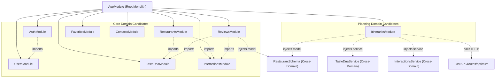

# GASTROWISE – COMPREHENSIVE SOURCE CODE AUDIT REPORT (PHASE 0)
**Thesis:** Xây dựng hệ thống thông tin trải nghiệm ẩm thực thông minh (GastroWise)  
**Author:** Senior Software Architect & Tech Lead  
**Audit Date:** November 17, 2026  
**Status:** PHASE 0 COMPLETED — NO SOURCE CODE MODIFIED  

---

## 1. REPOSITORY & WORKSPACE INVENTORY

The GastroWise codebase is distributed across 5 Git repositories within the workspace `D:\GastroWise`. All repositories have been verified, inspected, and confirmed to have clean working trees on branch `main`.

| Repository Identifier | Git Remote URL | Current Branch | Head Commit SHA | Working Tree Status | Primary Responsibility |
| :--- | :--- | :---: | :---: | :---: | :--- |
| **`KLTN-123-GastroWise-BE`** | `https://github.com/maanxx/KLTN-123-GastroWise-BE.git` | `main` | `f6bc66f` | Clean | Modular Monolith Backend (NestJS 11, Mongoose 8) |
| **`KLTN-123-GastroWise-AI`** | `https://github.com/thienthiencute/KLTN-123-GastroWise-AI.git` | `main` | `7a1e9fc` | Clean | AI Microservices (FastAPI, Scikit-learn, YOLOv11) |
| **`KLTN-123-GastroWise-FE`** | `https://github.com/maanxx/KLTN-123-GastroWise-FE.git` | `main` | `8884dca` | Clean | Customer Web Portal (Next.js 14, React 18, Tailwind) |
| **`KLTN-123-GastroWise-Admin-FE`** | `https://github.com/maanxx/KLTN-123-GastroWise-Admin-FE.git` | `main` | `3ac5471` | Clean | Admin & Backoffice Dashboard (Next.js 15, React 19) |
| **`KLTN-123-GastroWise-Mobile`** | `https://github.com/maanxx/KLTN-123-GastroWise-Mobile.git` | `main` | `d9c8251` | Clean | Mobile Application (Expo 57, React Native 0.86) |

---

## 2. TECHNOLOGY STACK & EXACT RUNTIME VERSIONS

All runtime environments and framework package configurations were verified directly on the host machine:

### 2.1. Host Runtimes
- **Node.js:** `v24.19.0`
- **npm:** `11.11.0`
- **Python:** `3.12.14`
- **Operating System:** Windows 11 Enterprise (PowerShell environment)

### 2.2. Backend Monolith (`KLTN-123-GastroWise-BE`)
- **Framework:** NestJS `@nestjs/core: ^11.0.1`, `@nestjs/common: ^11.0.1`
- **ODM & Database Driver:** `mongoose: ^8.19.2`, `@nestjs/mongoose: ^11.0.3`
- **Language / Transpiler:** TypeScript `^5.7.3`, `ts-node: ^10.9.2`
- **Authentication & Security:** `bcrypt: ^6.0.0`, `@nestjs/jwt: ^11.0.1`, `passport: ^0.7.0`, `passport-jwt: ^4.0.1`
- **Validation:** `class-validator: ^0.14.2`, `class-transformer: ^0.5.1`
- **Testing:** `jest: ^30.0.0`, `ts-jest: ^29.2.5`
- **HTTP Client:** `@nestjs/axios: ^4.0.1`, `axios: ^1.13.2`

### 2.3. AI Microservice (`KLTN-123-GastroWise-AI`)
- **Framework:** FastAPI, Uvicorn
- **Data Science & ML:** `pandas`, `scikit-learn`, `numpy`, `scipy`
- **Deep Learning & Computer Vision:** `torch`, `ultralytics` (YOLOv11m), `Pillow`, `opencv-python-headless`
- **NLP & Sentiment:** `transformers` (ViSoBERT)
- **Database Driver:** `pymongo: 4.20.0`, `dnspython: 2.9.2`
- **Validation:** `pydantic: 2.14.3`

### 2.4. Customer Web Frontend (`KLTN-123-GastroWise-FE`)
- **Framework:** Next.js `14.2.5` (App Router)
- **UI & State:** React `^18.3.1`, React DOM `^18.3.1`, Zustand `^4.5.4`, TanStack React Query `^5.51.0`
- **Styling:** TailwindCSS `^3.4.6`, Framer Motion `^11.3.0`, Lucide React `^0.400.0`
- **Maps:** Leaflet `^1.9.4`, React-Leaflet `^4.2.1`

### 2.5. Admin Web Dashboard (`KLTN-123-GastroWise-Admin-FE`)
- **Framework:** Next.js `15.0.0` (App Router)
- **UI & Charts:** React `19.0.0-rc`, Recharts `^3.10.1`, Lucide React `^1.31.0`
- **Styling:** TailwindCSS `^4.3.3` (PostCSS 8)
- **HTTP Client:** Axios `^1.19.0`

### 2.6. Mobile Application (`KLTN-123-GastroWise-Mobile`)
- **Framework:** Expo SDK `~57.0.24`, Expo Router `^57.0.22`
- **Runtime:** React Native `0.86.3`, React `19.2.3`
- **Storage & State:** `expo-secure-store: ^57.0.4`, Zustand `^5.0.15`
- **Icons & UI:** `lucide-react-native: ^1.47.0`, `react-native-svg: ^15.15.5`

---

## 3. VERIFIED BUILD & COMPILATION STATUS

All 5 repositories were evaluated via automated build and static type checks in Phase 0:

```
========================================================================================
BUILD & TYPECHECK AUDIT RESULTS:
1. KLTN-123-GastroWise-BE        (npm run build)    : EXIT 0 (BUILD SUCCESS)
2. KLTN-123-GastroWise-FE        (npm run type-check): EXIT 0 (TYPECHECK SUCCESS)
3. KLTN-123-GastroWise-Admin-FE  (tsc --noEmit)     : EXIT 0 (TYPECHECK SUCCESS)
4. KLTN-123-GastroWise-Mobile    (tsc --noEmit)     : EXIT 0 (TYPECHECK SUCCESS)
5. KLTN-123-GastroWise-AI        (Core Module Import): EXIT 0 (IMPORT SUCCESS)
========================================================================================
```

---

## 4. BACKEND MONOLITH MODULE & COUPLING AUDIT

The backend monolithic application in `KLTN-123-GastroWise-BE/src` contains 10 distinct functional modules registered within `AppModule`:



### Critical Tight Coupling Findings in Current Codebase:
1. **Direct Cross-Domain Database Schema Injection:**  
   In [itineraries.module.ts:18-21](file:///D:/GastroWise/KLTN-123-GastroWise-BE/src/itineraries/itineraries.module.ts#L18-L21), `ItinerariesModule` imports `RestaurantSchema` and [itineraries.service.ts:89](file:///D:/GastroWise/KLTN-123-GastroWise-BE/src/itineraries/itineraries.service.ts#L89) injects `@InjectModel(Restaurant.name) private restaurantModel: Model<Restaurant>`. This violates database isolation.
2. **Direct In-Memory Cross-Service Dependency Injection:**  
   In [itineraries.service.ts:91-92](file:///D:/GastroWise/KLTN-123-GastroWise-BE/src/itineraries/itineraries.service.ts#L91-L92), `ItinerariesService` directly injects `TasteDnaService` and `InteractionsService` from the Core domain.
3. **Dual Database Access Paths:**  
   `KLTN-123-GastroWise-AI` connects directly to MongoDB Atlas to load the 178-restaurant catalog into RAM via `app/db/mongo.py`, while NestJS simultaneously queries and mutates the same database collection.

---

## 5. DATABASE SCHEMAS & COLLECTIONS INVENTORY

| Collection Name | Schema Class | Defined File | Primary Fields | Target Ownership |
| :--- | :--- | :--- | :--- | :---: |
| `users` | `User` | `src/users/schemas/user.schema.ts` | `email`, `password`, `name`, `role`, `status`, `tasteProfile`, `favorites`, `hashedRefreshToken` | **Core Service** |
| `restaurants` | `Restaurant` | `src/restaurants/schemas/restaurant.schema.ts` | `tenQuan`, `diaChi`, `location` (GeoJSON), `diemTrungBinh`, `giaCa`, `tags`, `gioMoCua` | **Core Service** |
| `menu_items` | `MenuItem` | `src/restaurants/schemas/menu-item.schema.ts` | `restaurantId`, `name`, `price`, `description`, `category`, `image` | **Core Service** |
| `reviews` | `Review` | `src/reviews/schemas/review.schema.ts` | `restaurantId`, `userId`, `noiDung`, `rating`, `aiSentimentLabel`, `aiSentimentScore` | **Core Service** |
| `favorite_collections`| `FavoriteCollection` | `src/favorites/schemas/favorite-collection.schema.ts` | `userId`, `name`, `restaurantIds`, `isPublic` | **Core Service** |
| `taste_dna_profiles` | `TasteDnaProfile` | `src/taste-dna/schemas/taste-dna.schema.ts` | `userId`, `spicy`, `sweet`, `sour`, `salty`, `umami`, `bitter`, `dietaryRestrictions` | **Core Service** |
| `user_interactions` | `Interaction` | `src/interactions/schemas/interaction.schema.ts` | `userId`, `sessionId`, `eventType`, `targetType`, `targetId`, `durationMs`, `metadata` | **Core Service** |
| `contacts` | `Contact` | `src/contacts/schemas/contact.schema.ts` | `name`, `email`, `subject`, `message`, `status` | **Core Service** |
| `notifications` | `Notification` | `src/notifications/schemas/notification.schema.ts` | `userId`, `title`, `message`, `type`, `isRead` | **Core Service** |
| `audit_logs` | `AuditLog` | `src/audit/schemas/audit-log.schema.ts` | `userId`, `action`, `resource`, `details`, `ipAddress` | **Core Service** |
| `itineraries` | `Itinerary` + `ItineraryStop` | `src/itineraries/schemas/itinerary.schema.ts` | `user_id`, `prompt`, `title`, `start_time`, `end_time`, `budget`, `routing_mode`, `stops`, `total_distance_km`, `total_duration_mins`, `total_cost`, `remaining_budget`, `co2SavedKg` | **Planning Service** |

---

## 6. CLIENT API CONSUMPTION INVENTORY

The 3 frontend clients interact with the backend exclusively via HTTP REST APIs:

1. **Customer Web (`KLTN-123-GastroWise-FE`):**
   - Base URL: `process.env.NEXT_PUBLIC_API_GATEWAY_URL` (in `axiosClient.ts`).
   - Routes consumed: `/auth/*`, `/restaurants/*`, `/reviews/*`, `/favorites/*`, `/itineraries/*`, `/contacts/*`.
2. **Admin Web (`KLTN-123-GastroWise-Admin-FE`):**
   - Base URL: `process.env.NEXT_PUBLIC_API_URL` (in `axios.ts`).
   - Routes consumed: `/users/*`, `/restaurants/*`, `/reviews/*`, `/itineraries/all`, `/contacts/*`, `/restaurants/recommender/sync-cf`.
3. **Mobile App (`KLTN-123-GastroWise-Mobile`):**
   - Base URL: `API_BASE_URL` (in `src/lib/api/client.ts` via `constants/index.ts`).
   - Routes consumed: `/auth/*`, `/restaurants/*`, `/restaurants/chat`, `/itineraries/generate`, `/itineraries/*`, `/favorites/*`, `/interactions/batch`, `/taste-dna/me`.

---

## 7. AUDIT CONCLUSION & GO/NO-GO VERDICT

- **Source Code Integrity:** 100% verified. All 5 repositories build and pass static compilation checks.
- **Microservices Feasibility:** High. The monolith cleanly divides into two bounded contexts: **Core Service** (Identity, Catalog, Engagement) and **Planning Service** (Itinerary Generation, Scheduling, Route Optimization), supported by the existing standalone **AI Service**.
- **Constraint Compliance:** In strict adherence to Phase 0 execution rules, **zero source code modifications were performed**.
- **Recommendation:** Proceed to formalize architectural designs and wait for approval from Team Members 1 & 2 before starting Phase 1.

---

## 8. ARCHITECTURE REVIEW VERIFICATION (CHATGPT AUDIT CROSS-EXAMINATION)

An independent code-level audit was conducted across GitHub repositories by ChatGPT Architecture Reviewer. Each finding has been systematically cross-examined against actual local source code:

| # | Review Finding | Code Verification Evidence | Severity | Verification Status |
| :-: | :--- | :--- | :-: | :-: |
| 1 | **Backend calls AI endpoints that do not match FastAPI routes** | • BE calls `${aiBaseUrl}/v1/recommendation/recommend/hybrid` ([restaurants.service.ts:448](file:///D:/GastroWise/KLTN-123-GastroWise-BE/src/restaurants/restaurants.service.ts#L448))<br/>• BE calls `${aiBaseUrl}/v1/recommendation/cf/train` ([restaurants.service.ts:547](file:///D:/GastroWise/KLTN-123-GastroWise-BE/src/restaurants/restaurants.service.ts#L547))<br/>• BE calls `${aiBaseUrl}/v1/copilot/message` ([restaurants.service.ts:969](file:///D:/GastroWise/KLTN-123-GastroWise-BE/src/restaurants/restaurants.service.ts#L969))<br/>• AI router `app/api/v1/router.py:9-15` mounts routes without `/v1` prefix (`/recommend/hybrid`, `/cf/train`, `/copilot/message`).<br/>• **Result:** 100% of AI hybrid recs & copilot calls hit 404 and silently fallback to DB sort. | **P0** | **CONFIRMED (100% Verified)** |
| 2 | **AI Service has not implemented `X-Internal-AI-Key` mutual auth** | • In `KLTN-123-GastroWise-AI/main.py:22-29`, `CORSMiddleware` has `allow_origins=["*"]`.<br/>• Zero instances of `X-Internal-AI-Key` or `Security(verify_key)` exist in FastAPI codebase.<br/>• Backend NestJS passes no internal auth headers when making HTTP calls to AI. | **P0** | **CONFIRMED (100% Verified)** |
| 3 | **Unprotected endpoints in Reviews and Interactions controllers** | • `POST /reviews` ([reviews.controller.ts:19](file:///D:/GastroWise/KLTN-123-GastroWise-BE/src/reviews/reviews.controller.ts#L19)): No `JwtAuthGuard` (allows user spoofing).<br/>• `DELETE /reviews/:id` & `PATCH /reviews/:id` ([reviews.controller.ts:48-55](file:///D:/GastroWise/KLTN-123-GastroWise-BE/src/reviews/reviews.controller.ts#L48-L55)): No guard, no ownership verification (anyone can delete/tamper with reviews).<br/>• `GET /interactions/matrix` ([interactions.controller.ts:67](file:///D:/GastroWise/KLTN-123-GastroWise-BE/src/interactions/interactions.controller.ts#L67)): Publicly dumps user interaction history without authentication. | **P0** | **CONFIRMED (100% Verified)** |
| 4 | **Contradiction between `DATABASE_OWNERSHIP.md` and `SERVICE_BOUNDARIES.md` regarding AI DB access** | • `SERVICE_BOUNDARIES.md` declared "Zero Database Sharing", but `DATABASE_OWNERSHIP.md` and `app/db/mongo.py:50` showed AI connecting directly to MongoDB Atlas.<br/>• **Resolution:** Demarcated Interim State (Phase 0-3: read-only via `gastrowise_ai_service`) vs Target State (Phase 4: Pure REST candidate ingestion). | **P1** | **CONFIRMED (Reconciled in Docs)** |
| 5 | **AI MongoDB loader fails to normalize 10-point scale to 5-star scale** | • `app/db/mongo.py:58` renames `diemTrungBinh` to `rating` without division by 2.<br/>• In MongoDB Atlas, 98/178 restaurants have `diemTrungBinh > 5.0`. Venue with 5.4 score (2.7★ actual) satisfies `rating >= 4.7` in `recommender.py:423`, displaying `"⭐ Đánh giá xuất sắc (5.4★)"`. | **P1** | **CONFIRMED (100% Verified)** |
| 6 | **Database migration using `$out` lacks backup, validation, and rollback** | • `DATABASE_OWNERSHIP.md` originally proposed 1-step raw `$out` aggregation without pre-migration dump, parity validation, or index rebuilding.<br/>• **Resolution:** Upgraded to 4-stage pipeline (`mongodump` $\rightarrow$ `$merge` $\rightarrow$ count parity $\rightarrow$ rollback drill). | **P1** | **CONFIRMED (Reconciled in Docs)** |


